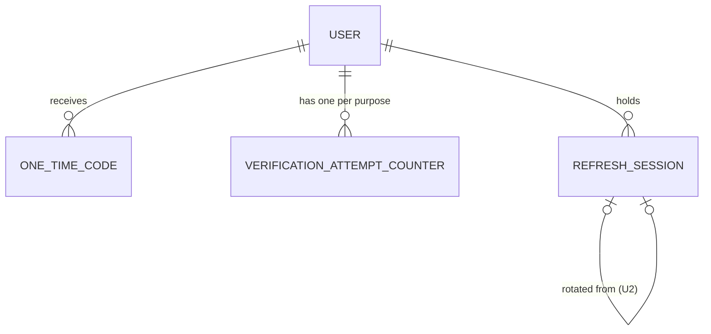

# Functional Specification — U1 Walking Skeleton

**Unit:** U1 `u1-walking-skeleton`. It covers the thin end-to-end slice and the project groundwork.

**Stories:** US1.1, US1.2, US1.3, US1.4, US1.5, US1.6, US1.8, US1.9, US3.1, US3.2, US3.4, US3.8.

This file is the source of truth for **workflows and state transitions**. Entity shapes are in `entities.md` and decision rules in `rules.md`; the ER diagram and rules summary below are derived from them.

The external API shapes are in `inception/contract-design/contract-summary.md` (C1 `/auth/*`, C11 errors). This unit implements:
- `POST /auth/register`
- `POST /auth/verify`
- `POST /auth/login`
- `GET /auth/me`
- `GET /health`

Decisions from this unit's questions:
- **Q1:** every code is 6 digits.
- **Q2:** signed-in users see a placeholder page.
- **Q3:** a reload signs the user out until U2.

---

## 1. Workflows

### WF-U1-1 — Sign up (step 1)
**Actor:** visitor. **Trigger:** submits the sign-up form.
1. The frontend validates full name, email and the password rule (BR1.1, BR1.2) and shows inline errors before sending.
2. The API client sends `POST /auth/register` with full name, email and password (BR5.2).
3. The backend normalises the email (trim, lower-case) and validates again (BR1.1, BR1.2).
4. Lookup by email:
   - a **verified user exists** → refuse `EMAIL_ALREADY_REGISTERED` (BR1.3);
   - an **unverified user exists** → check the cooldown (BR2.6). Within 60 s → `CODE_RESEND_COOLDOWN`. Otherwise update the full name and password hash (BR1.4, BR1.5);
   - **no user** → create User (unverified, role `user`) with the hashed password (BR1.5, BR1.6).
5. Issue a code (WF-U1-4) for purpose `signup`.
6. Send the email through the email adapter (BR7.4). If the send fails → `UPSTREAM_UNAVAILABLE`/`UPSTREAM_TIMEOUT`. The user and code rows stay, so a later resend works (contract open question C11).
7. Respond 202 with `maskedEmail`, `resendAvailableAt` and `expiresAt`. No token and no cookie (BR1.7, BR2.8).
8. The frontend shows **Check your email** with the masked address.

**Error paths:** 422 validation (inline per field) · 409 already registered (message plus "Sign in instead?") · 429 cooldown (seconds shown) · 502/504 (toast "We couldn't send the email. Please try again.").

### WF-U1-2 — Verify code (sign-up step 2, or login step 2)
**Actor:** visitor. **Trigger:** enters the 6-digit code.
1. The frontend sends `POST /auth/verify` with email, code and purpose (`signup` or `login`).
2. The backend loads the user. A missing user is treated as a wrong code (no enumeration).
3. Check the lockout: while `lockedUntil > now` → `CODE_LOCKED` with Retry-After (BR2.7).
4. Find the live code for (user, purpose): not consumed, not superseded (BR2.4, BR2.5).
   - None → count a failure, then `CODE_INVALID`.
   - Expired (`now >= expiresAt`) → `CODE_EXPIRED` (BR2.3). This does not count as a failure.
5. Compare the hash. On a mismatch, `failedCount += 1`. At 5 failures, set `lockedUntil = now + 15 min` → `CODE_LOCKED`; otherwise → `CODE_INVALID` with `attemptsLeft` (BR2.7).
6. On a match:
   - consume the code and reset `failedCount`;
   - for `signup`, set `isVerified = true` and `verifiedAt`;
   - create a RefreshSession with a new family (BR3.3, BR4.2);
   - sign the access token (BR4.1).
7. Respond 200 with `accessToken`, `expiresAt` and `user`, plus `Set-Cookie: refresh_token` (httpOnly, 7 days).
8. The frontend auth store saves the token and profile in memory (BR5.1) and routes to the signed-in placeholder page.

### WF-U1-3 — Log in (step 1)
**Actor:** returning user. **Trigger:** submits email and password.
1. `POST /auth/login` with email and password.
2. The backend looks up the normalised email. If no user, or the user is unverified, run a dummy hash and → `INVALID_CREDENTIALS` (BR3.1). An unverified user is told to sign up again, which re-sends the code (BR1.4). The message is the same generic one.
3. Verify the password hash. On a mismatch → `INVALID_CREDENTIALS`.
4. Check the cooldown (BR2.6). Within 60 s of the last login code → `CODE_RESEND_COOLDOWN`.
5. Issue a code for purpose `login` (WF-U1-4), send the email, and respond 202 (BR3.2, BR1.7).
6. The frontend shows **Check your email**, then follows WF-U1-2 with purpose `login`.

### WF-U1-4 — Issue a code (internal)
1. Generate 6 secure random digits (BR2.1).
2. Mark any live code for (user, purpose) as superseded (BR2.6).
3. Store a keyed hash with `issuedAt` and `expiresAt = issuedAt + 10 min` (BR2.2, BR2.3).
4. Set `lastSentAt = now` on the attempt counter.
5. Return the plain code only to the email step. It is never logged (BR6.3).

### WF-U1-5 — Who am I and protected requests
1. The signed-in placeholder page calls `GET /auth/me` through the API client.
2. The backend auth dependency validates the token's signature, algorithm (allow-list; `none` is refused), expiry and type `access` (BR4.3). Any failure → `NOT_AUTHENTICATED`.
3. Return the profile (BR4.4). The page shows "Hi, {full name}" in the header and user menu (FD Q2).
4. The route-guard test builds the list of protected routes from the router minus the public allow-list: `/health`, `/auth/register`, `/auth/login`, `/auth/verify`, plus the U2 public auth routes later.

### WF-U1-6 — Page reload (until U2)
1. On load, the auth store starts empty (BR5.4).
2. A protected page with no token routes to **Log in**.
3. The refresh cookie set in WF-U1-2 stays in the browser. U2 adds the restore call on start.

### WF-U1-7 — Developer groundwork flow (P4)
1. Clone, then `docker compose up` (PostgreSQL + mail catcher), then copy `.env.example` → `.env` for each app (BR8.3).
2. Backend: install, `alembic upgrade head`, run the web server. Frontend: install, run the dev server.
3. Before commit, the Gitleaks hook scans staged files (BR8.9).
4. On a pull request, CI runs (per app):
   - lint (including security rules);
   - format check;
   - type check;
   - tests with ≥80% coverage and no network;
   - the Alembic round-trip;
   - audits;
   - the auth-SaaS deny-list;
   - the layering rules;
   - the Playwright skeleton journey.

   `main` is protected (BR8.4–BR8.10).
5. The verification command `make verify` runs the same checks locally. It is proposed for your approval at the skeleton checkpoint.

## 2. State machines

### User verification
| From | Event | Guard | To | Actions |
|---|---|---|---|---|
| (none) | register | email not used by a verified user | Unverified | hash password, issue signup code |
| Unverified | register again | cooldown passed | Unverified | update name and hash, supersede and issue code |
| Unverified | verify signup code | code live, matches, not locked | Verified | consume code, set verifiedAt, start session |
| Verified | register | — | Verified | refuse EMAIL_ALREADY_REGISTERED |

### One-time code
| From | Event | Guard | To |
|---|---|---|---|
| (none) | issue | cooldown passed | Live |
| Live | correct code entered | now < expiresAt, not locked | Consumed |
| Live | newer code issued | same user and purpose | Superseded |
| Live | time passes | now ≥ expiresAt | Expired |
| Consumed / Superseded / Expired | any verify | — | (unchanged; refused) |

### Verification attempts (per user and purpose)
| From | Event | Guard | To | Actions |
|---|---|---|---|---|
| Open (count n<4) | wrong code | — | Open (n+1) | return attemptsLeft = 5 − (n+1) |
| Open (n=4) | wrong code | — | Locked | lockedUntil = now + 15 min |
| Locked | any verify | now < lockedUntil | Locked | refuse CODE_LOCKED |
| Locked | time passes | now ≥ lockedUntil | Open (0) | — |
| Open | correct code | — | Open (0) | reset |

### Frontend session (U1 part)
| From | Event | To |
|---|---|---|
| Signed out | verify succeeds | Signed in (token in memory) |
| Signed in | page reload | Signed out (until U2) |
| Signed in | access token expires | Signed out on next 401 (silent refresh arrives in U2) |

## 3. Entity relationship view (derived from `entities.md`)

Text fallback: a User has many OneTimeCodes, one attempt counter per purpose, and many RefreshSessions. A RefreshSession may have a parent session (rotation, used from U2).

## 4. Rules summary (derived from `rules.md`)
- **Sign-up:** valid input, the password rule (8+ characters, a letter and a number, not common), unique verified email, re-sign-up re-sends the code, slow hash, role `user`, no early tokens.
- **Codes:** 6 random digits, hashed, valid < 10:00, single use, purpose-bound, 60 s cooldown that supersedes the old code, 5 failures → 15-minute lock, masked email.
- **Login:** generic failure, a code on success, tokens on verify.
- **Tokens:** 15-minute access token, 7-day httpOnly refresh cookie stored as an id plus a hash, every non-public route validated, "who am I".
- **Frontend:** memory-only store, single API client, UI reads selectors only, reload signs out until U2.
- **Safety:** shared error format, 404 for others' records, no secrets in logs.
- **Config and vendors:** typed settings, secrets only when a real adapter is selected, no literals, email adapter with timeout, a test fake that production can't use, the mail catcher locally.
- **Engineering:** repo shape, `.gitignore`, local environment, migrations, host-neutral, CI gates, offline tests, layering lint, security tooling, no auth-as-a-service.

## 5. Integration points
- **Email adapter port** (contract C10 `EmailSender`): an SMTP adapter to the mail catcher locally, and a recording fake in tests.
- **Auth dependency** (C3 `get_current_user`): provided here and used by every later unit.
- **Error mapping** (C11): the shared handler covers framework-generated validation, 401, 404 and 405 errors as well (contract review R-07).
- **Frontend API client:** created here and reused by every later unit; types are generated from the backend OpenAPI document (contract Q6).

## 6. Edge cases
- The email has different case or spaces → normalised, so it maps to the same account.
- Two sign-up submissions at the same time for one new email → a unique constraint on the normalised email; the second gets the cooldown or the "already registered" path.
- The code is entered exactly at 10:00 → expired.
- The 5th wrong code → locked immediately; a correct code during the lock is refused.
- An unknown email at verify → `CODE_INVALID`, the same as a wrong code.
- A reload after sign-in → signed out (accepted until U2).
- The email send fails after the user row is written → the user can resend after the cooldown. No orphan code can be verified without the email.
