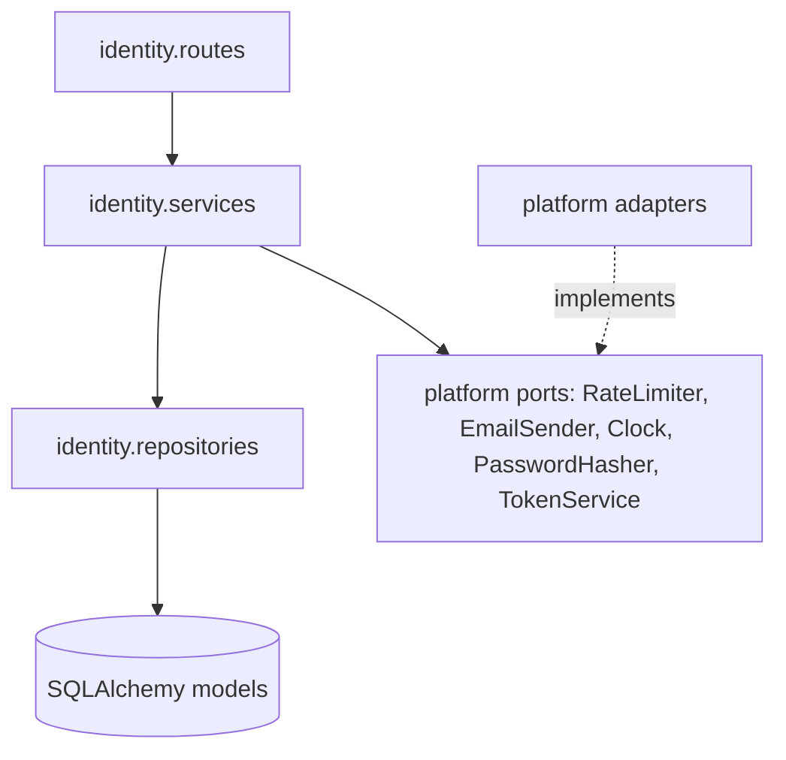

# Logical Components — U1 Walking Skeleton

**Sources:** the NFR design files in this folder, `tech-stack-decisions.md` (NFR1.x, NFR7.x, NFR8.x), and `inception/domain-design/components.md` (Identity, WebAuthClient, WebApp).

## 1. Component inventory

| Component | Kind | Owns | NFR patterns applied | Failure domain |
|---|---|---|---|---|
| `web` (Next.js app) | Process | Pages, CSP middleware, `apiClient`, in-memory auth store | Strict CSP, in-memory tokens, request-id surfacing | Browser tab / frontend process |
| `api` (FastAPI app) | Process | Middleware stack, routers, Identity services | Request id, body guard, CORS, headers, auth dependency, error envelope | API process |
| Identity module | Module in `api` | `users`, `one_time_codes`, `verification_attempts`, `refresh_sessions` | Argon2id, HMAC codes, atomic verify, JWT `kid` | Shared with `api` |
| Platform module | Module in `api` | Settings, DB session, logging, metrics, `RateLimiter`, `RetryPolicy`, `EmailSender` ports | Fail-fast settings, pooling, limiter, retry budget | Shared with `api` |
| Email adapter | Adapter | SMTP or fake sending | Retry with budget; commit → send → compensate | One request |
| PostgreSQL | Data store | All U1 state plus `rate_limit_hits` | Row locks, unique indexes, migrations | Whole system (single dependency) |
| Mailpit | Dev and test service | Captured emails | Lets Playwright read codes over its HTTP API (NFR8.4) | Development and CI only |

## 2. Dependency direction (lint-enforced, NFR7.2)

Text fallback: identity routes call identity services. Services call repositories and the platform ports. Repositories use SQLAlchemy models. Platform adapters implement the ports. Import-linter forbids routes from importing repositories or adapters directly, and forbids any module from importing identity internals other than `identity.public`.

Frontend rule: components under `app/` and `components/` may not import `lib/auth/api` or the store's setters; they use the `useAuth()` hook (Section 5.3).

## 3. Shared resources and blast radius

| Shared resource | Shared by | Risk | Isolation |
|---|---|---|---|
| Database pool (5 + 5) | All API requests | Exhaustion stalls the API | No outside calls inside transactions (NFR5.13); 5 s pool timeout; limiter on its own short session |
| Thread pool (AnyIO default 40) | Sync endpoints, Argon2, database work | Slow email sends could occupy every thread | Bulkhead: email sends use their own `CapacityLimiter` (10), so at least 30 threads stay free; health routes are `async def`; 25 s watchdog-enforced send budget; hourly email cap; per-IP limiter (reliability design §2) |
| `CODE_HMAC_KEY`, `JWT_SIGNING_KEYS` | Identity services | A leak lets codes or tokens be forged | Environment only, `SecretStr`, Gitleaks, rotation via `kid` |
| Email provider | Sign-up and login | Outage blocks new sessions only | Budgeted retries; existing sessions unaffected |

## 4. Local and CI topology (Docker Compose)

| Service | Image or command | Ports | Healthcheck |
|---|---|---|---|
| `postgres` | `postgres:16` | 5432 | `pg_isready` |
| `mailpit` | `axllent/mailpit` | 1025 (SMTP), 8025 (HTTP API) | HTTP 200 on `/livez` |
| `api` | `uv run uvicorn app.main:app` (host process in development; container in the CI e2e job) | 8000 | `GET /health/ready` |
| `web` | `pnpm dev` or `pnpm start` | 3000 | HTTP 200 on `/login` |

Infrastructure Design turns this table into the Compose file and the CI job. No cloud resources are designed in this unit (NFR11).

## 5. Quality gates and CI jobs

| Gate | Where it runs | What it enforces | Requirement |
|---|---|---|---|
| `backend` CI job | GitHub Actions, Python 3.12 + uv, a `postgres:16` service container | `ruff check`, `ruff format --check`, `mypy --strict app`, `lint-imports` (import-linter), `pytest --cov=app --cov-fail-under=80` | NFR1.1, NFR7.1, NFR7.2, NFR8.1 |
| `frontend` CI job | Node 22 + pnpm | `eslint`, `prettier --check`, `tsc --noEmit`, `vitest run --coverage` (80% line threshold in `vitest.config.ts`), `pnpm build`, bundle-size script | NFR1.1, NFR7.1, NFR8.1, NFR9.5 |
| `e2e` CI job | Compose `postgres` + `mailpit`, the API, and the production web build | Alembic `upgrade head` → `downgrade base` → `upgrade head`, then the Playwright journey (two viewports, axe) | NFR1.2, NFR8.4, NFR9.6, NFR9.7 |
| `security` CI job | Any runner | Gitleaks, `pip-audit`, `pnpm audit --prod`, lockfile deny-list | NFR1.3, NFR2.1, NFR6.1 |
| Network isolation in tests | `pytest-socket` with `--disable-socket --allow-hosts=127.0.0.1,localhost` (the test database only); Vitest stubs `fetch` globally | No paid or external calls in the default run | NFR8.2 |
| Test-first ordering | Code Generation plan: for `TokenService`, the code issue and verify services, and the frontend `apiClient` refresh single-flight, tests are written and run red before the implementation commit | Team Testing Posture (custom) | NFR8.3 |
| READMEs | `backend/README.md` and `frontend/README.md` (setup, environment variables, commands); root `README.md` (Compose, `make verify`). Services carry docstrings, checked by Ruff `D` rules on `app/**/services` | NFR7.3 |

Each app builds and tests in its own job with no shared build step, so both are proven independently buildable on every pull request (NFR1.1). `make verify` runs the same commands locally.
