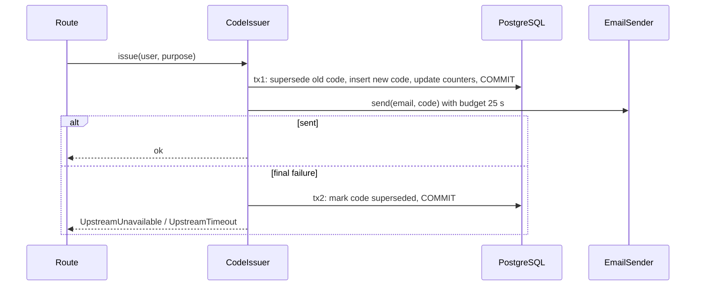

# Reliability Design — U1 Walking Skeleton

**Sources:** `nfr-requirements/reliability-requirements.md` (NFR5.1–NFR5.5, NFR5.13, NFR12.x) and NFR design answer Q1 (no circuit breaker yet).

## 1. Failure-mode table

| Dependency | Failure | Behaviour | Blast radius | Recovery |
|---|---|---|---|---|
| Email provider | Timeout, connection error, 4xx/5xx | Retry within the 25 s budget; then 502/504 and the code is superseded | One sign-up or login attempt | User retries after the 60 s cooldown; automatic when the provider recovers |
| PostgreSQL | Unreachable at start-up | The process exits non-zero with a clear message | Whole API (fail fast) | Start the database, restart the process |
| PostgreSQL | Error mid-request | Rollback; 500 `INTERNAL_ERROR` logged with request id | One request | Automatic on the next request |
| PostgreSQL | Pool exhausted | Waits up to `DB_POOL_TIMEOUT` (5 s), then 500 | Concurrent requests | Load drops, or pool tuning (NFR11.5) |
| Frontend → API | Network error or 30 s timeout | A friendly retry message on the form; no partial state | One browser tab | User retries |

## 2. Email sending (NFR5.1, NFR5.3, NFR5.13)

The design follows a **commit → send → compensate** sequence. The email call never holds a database connection or a row lock.

Text fallback: the code issuer commits the new code in transaction 1 and releases the connection, then sends the email with a 25-second budget. On final failure, a short transaction 2 marks the code superseded, and the route returns 502 or 504.

**Retry policy (`RetryPolicy`, shared by later vendor adapters):**
- Maximum attempts: 3 (1 + 2 retries).
- Delay = `min(4 s, 0.5 s × 2^attempt) + random(0, 250 ms)`.
- Per-attempt timeout = `min(10 s, remaining_budget)`. No attempt starts with less than 2 s remaining.
- Retryable: connection errors, timeouts, SMTP 421/450/451/452 and 5xx from HTTP providers. Not retryable: SMTP 550/553 and other permanent rejections.
- The total budget is 25 s, measured from the first attempt (NFR5.3).

**Isolating slow sends (bulkhead, review R-02):** slow email must not use up the threads that verify, `/auth/me` and health need.
- The register and login routes are `async def`. Their blocking steps run through `anyio.to_thread.run_sync`:
  - tx1, tx2 and Argon2 use the default limiter (AnyIO's default of 40 tokens, left unchanged and documented);
  - the email send uses a dedicated `CapacityLimiter(EMAIL_MAX_CONCURRENCY)` (default 10), created in the app lifespan because limiters belong to the running event loop.
- At most 10 threads are ever blocked on email, so at least 30 stay free for verify, `/auth/me` and the other sync routes.
- `/health` and `/health/ready` are `async def` and use no threads. Readiness runs `SELECT 1` through the same `to_thread` call with a 2 s `anyio.fail_after`.
- Waiting for an email slot counts against the 25 s budget. If no slot frees in time, the send ends as `UPSTREAM_UNAVAILABLE` (503), and tx2 supersedes the code.

**Enforcing the 25 s deadline around `smtplib` (review R-02):** socket timeouts apply to each blocking call, not to the whole send, so the adapter enforces the deadline in three ways:
- **Per-attempt socket timeout:** each attempt opens `smtplib.SMTP(host, port, timeout=min(10, remaining))`.
- **Per-call check:** before each SMTP command (connect, EHLO, STARTTLS, AUTH, MAIL/RCPT/DATA), the adapter checks the remaining budget and aborts if it is under 1 s.
- **Watchdog:** a `threading.Timer(remaining)` calls `smtp.sock.shutdown(SHUT_RDWR)` at the deadline, which makes any pending call fail at once. The timer is cancelled when the attempt ends.

Together these bound the send at 25 s, plus up to 1 s to close the socket. A test with a fake SMTP server that stalls after `DATA` checks this.

**No circuit breaker (answer Q1):** at launch volume, a breaker adds state without real benefit. Every request already fails within its budget. Revisit when traffic or a second vendor call path exists. The `EmailSender` port makes adding one a single-adapter change.

## 3. Transactions (NFR5.4)
- One `Session` per request from a `get_session` dependency, with `expire_on_commit=False`.
- Services take the session and commit explicitly. The dependency rolls back on any exception and always closes the session.
- Multi-step commands (verify, issue code) are one transaction each, except the email compensation (tx2), which is deliberately separate.
- No transaction spans an outside call.

## 4. Health and start-up (NFR5.5)

| Check | Path | Does | Used by |
|---|---|---|---|
| Liveness | `GET /health` (`async def`) | Returns `{"status":"ok"}` with no I/O and no thread | Process supervisors, NFR9.3 |
| Readiness | `GET /health/ready` (`async def`) | `SELECT 1` within 2 s; returns 200 or 503 with no details. The Alembic head check runs once at start-up, not on every probe | Compose healthcheck, `make verify`, future load balancer |
| Start-up | App lifespan | Validates settings, connects to the database, and checks that migrations are at head; exits with code 1 on failure | Fail fast |

Graceful shutdown: Uvicorn drains in-flight requests on SIGTERM (a 10 s timeout, set in the run command), and the lifespan disposes the engine.

## 5. Email templates (NFR12.1, NFR12.2)
Templates are a plain-text and an HTML Jinja2 file per purpose (`signup_code`, `login_code`). They contain the code, the expiry time ("valid for 10 minutes") and a "didn't ask for this?" line, with no images or links. The adapter is chosen by `EMAIL_BACKEND` (`smtp` or `fake`). Development uses SMTP to Mailpit on port 1025; tests use the recording fake.

## 6. Backup and recovery
Deferred until hosting is chosen. Locally, the `pgdata` Docker volume persists across restarts, and `make db-reset` recreates it.
