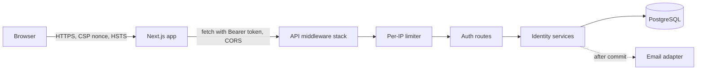

# Security Design — U1 Walking Skeleton

**Sources:** `nfr-requirements/security-requirements.md` (NFR2.x, NFR3.x, NFR6.x), `functional-design/functional-spec.md` (WF-U1-1 to WF-U1-7), `contract-summary.md` (C1 `/auth/*`, C11 error codes), and NFR design answer Q3. Revised after review iteration 1 (findings R-01, R-04, R-06 to R-09).

Security is designed in layers, so that one missing control does not open the slice.


Text fallback: the browser talks to the Next.js app over HTTPS with a strict CSP. The app calls the API cross-origin with a Bearer token. Each API request passes through the middleware stack, then the per-IP limiter (auth routes only), and then reaches the routes and services. Services keep state in PostgreSQL. Email is sent only after the database commit.

## 1. Backend request pipeline (outermost first)

| Order | Layer | What it enforces | Requirement |
|---|---|---|---|
| 1 | Request-id middleware | Accepts `X-Request-ID` only if it matches the canonical UUID pattern (36 characters); otherwise generates a UUID4. Sets it on the log context and the response | NFR5.7 |
| 2 | Access-log middleware | One `http.request` line per request: route template, or the fixed label `unmatched` for unknown paths; status; duration | NFR5.6 |
| 3 | CORS (Starlette `CORSMiddleware`) | Only the configured `FRONTEND_ORIGIN`, with credentials; the allowed and exposed headers listed in NFR2.12. It sits outside every rejecting layer, so browsers can read all error responses | NFR2.12 |
| 4 | Security-headers middleware | `nosniff`, `Referrer-Policy: no-referrer`, `Cache-Control: no-store` on `/auth/*`, HSTS outside development | NFR2.13, NFR3.5 |
| 5 | Body-size guard | On `/auth/*`, counts streamed bytes (works without `Content-Length`) and stops at 16 KB with 422 `VALIDATION_FAILED`, `details.reason = "BODY_TOO_LARGE"`. C11 has no generic 413 code, and 422 keeps the slice inside the contract | Resource limits, STRIDE DoS |
| 6 | Exception handlers | Map domain errors to the C11 envelope `{code, message, requestId}`. Unknown errors become `INTERNAL_ERROR`; stack traces go to logs only | NFR3.3, NFR5.9 |
| 7 | Per-IP limiter dependency | On register, login and verify only (see §4) | NFR2.9 |
| 8 | Auth dependency `current_user` | Applied to every router by default; public routes opt out explicitly | NFR2.8, NFR2.11 |

**Secure by default and route classes (NFR2.8):**
- **Protected:** every router is mounted with `dependencies=[Depends(current_user)]`.
- **Public:** one `public_router` holding exactly the paths in the constant `PUBLIC_ROUTES`: `/health`, `/health/ready`, `/auth/register`, `/auth/login`, `/auth/verify`.
- **Development-only:** `FastAPI(docs_url=None, redoc_url=None, openapi_url=None)` unless `APP_ENV=development`. In development, `/docs` and `/openapi.json` are enabled and listed in `DEV_ONLY_ROUTES`. TypeScript types are generated offline by `make openapi`, which calls `app.openapi()` in a script. It never fetches the HTTP route, so generation works in every environment.
- **Metrics:** `/metrics` is a separate ASGI sub-app mounted only when `METRICS_ENABLED=true`. Its own guard allows only clients in `METRICS_ALLOW_CIDRS` (others get 403). It is the one token-exempt route outside `PUBLIC_ROUTES`, listed in `OPERATIONAL_ROUTES`.
- **Start-up assertion:** the public router's paths must equal `PUBLIC_ROUTES`.
- **Route-enumeration test:** walks `app.routes` and expects 401 `NOT_AUTHENTICATED` without a token for every path outside `PUBLIC_ROUTES`, `DEV_ONLY_ROUTES` and `OPERATIONAL_ROUTES`. It also asserts that the development-only routes are 404 when `APP_ENV=production`, and that `/metrics` is 404 when disabled and 403 from outside its allow-list.

## 2. Credentials and codes

| Concern | Design | Requirement |
|---|---|---|
| Password hashing | `PasswordHasher` port with an Argon2id adapter (`argon2-cffi`; m=19 MiB, t=2, p=1; parameters from settings). `verify_and_maybe_rehash()` returns a new hash when the parameters change, and the login service stores it | NFR2.2 |
| Password policy | A pure `PasswordPolicy` check: 8–128 characters, at least one letter and one digit, not in a bundled 10k common-password list (loaded once into a frozenset) | NFR2.3 |
| Login enumeration | The login service always runs one Argon2 verification: against the stored hash, or a module-level dummy hash when the user is missing or unverified. Both cases return `INVALID_CREDENTIALS` | NFR2.4 |
| Code generation | `secrets.randbelow(10**6)`, zero-padded to 6 digits | NFR2.5 |
| Code storage | `HMAC-SHA256(CODE_HMAC_KEY, f"{user_id}:{purpose}:{code}")` as a hex digest, compared with `hmac.compare_digest` | NFR2.5 |
| Attempt counter row | One row per (user, purpose). Both the issue and verify paths first run `INSERT … ON CONFLICT (user_id, purpose) DO NOTHING`, then `SELECT … FOR UPDATE`. The row therefore always exists before it is locked, and two concurrent first issues cannot collide on the primary key | NFR2.5, NFR2.10 |
| Lock expiry | Before evaluating, a row with `locked_until <= now` is reset to `failed_count = 0, locked_until = NULL` (state machine: Locked → Open(0) when time passes) | NFR2.5 |

**Verify transaction (atomic, follows WF-U1-2; NFR2.10):**
```text
BEGIN
  user = SELECT users WHERE email_norm = :email
  if user is None: hmac over a dummy input; ROLLBACK → 400 CODE_INVALID          -- WF-U1-2 step 2
  upsert counter (INSERT … ON CONFLICT DO NOTHING); counter = SELECT … FOR UPDATE
  if counter.locked_until <= now: reset to 0 / NULL
  if counter.locked_until > now: COMMIT → 429 CODE_LOCKED + Retry-After        -- step 3
  code = live code for (user, purpose)            -- not consumed, not superseded
  if code is None: fail(counter) → CODE_INVALID or CODE_LOCKED                 -- step 4, counts
  if now >= code.expires_at: COMMIT → 400 CODE_EXPIRED                         -- step 4, no count
  if not compare_digest(hmac(user.id, purpose, input), code.hash): fail(counter) -- step 5
  UPDATE codes SET consumed_at = now WHERE id = :id AND consumed_at IS NULL     -- rowcount must be 1
  reset counter; mark verified (signup); create RefreshSession; COMMIT → 200    -- step 6
fail(counter): failed_count += 1; at 5 → locked_until = now + 15 min, COMMIT → 429 CODE_LOCKED;
               else COMMIT → 400 CODE_INVALID with attemptsLeft
```
- The counter row lock serialises parallel guesses.
- The conditional update means a second correct submission finds no live code, so it gets `CODE_INVALID` and counts as a failure.

**Existence signals (accepted risk):** for a real account, verify can reveal that the account exists, through `attemptsLeft`, `CODE_LOCKED` and `CODE_EXPIRED`. An unknown email always gets plain `CODE_INVALID`. We accept this because sign-up already reveals registration through the client-mandated `EMAIL_ALREADY_REGISTERED` (FR2.1, `AUTH-011`). Probing is bounded by the per-IP limiter (NFR2.9) and the 5-attempt lock. The unknown-user path computes one HMAC so its work is similar; its timing is not padded further.

## 3. Tokens and session cookie

| Concern | Design | Requirement |
|---|---|---|
| Access token | `TokenService.issue_access(user)` builds the claims `sub, role, iat, exp(+15m), typ="access", jti` and signs them with the active key. `JWT_SIGNING_KEYS` is a JSON map `kid → base64 secret`, and `JWT_ACTIVE_KID` selects the signing key | NFR2.6 |
| Verification | `jwt.decode(..., algorithms=["HS256"], options={"require": ["exp","iat","sub","typ"]})`. The key is selected by the header `kid`. An unknown `kid`, a bad signature or expiry, or a `typ` other than `access` gives 401 `NOT_AUTHENTICATED` (C11) | NFR2.6 |
| Start-up checks | Each key is at least 32 bytes, and `JWT_ACTIVE_KID` is a key in the map; otherwise start-up fails | NFR2.6, NFR6.1 |
| Rotation | Add the new `kid`, switch `JWT_ACTIVE_KID`, and remove the old key after 15 minutes. Both keys verify during the overlap | NFR2.6 |
| Code key rotation | Replacing `CODE_HMAC_KEY` makes live codes unverifiable (at most 10 minutes of codes); affected users request a new code. No dual-key support in U1 | NFR2.5 |
| Refresh cookie | 32 random bytes. The cookie value is `{token_id}.{base64url(secret)}`, and the database stores `sha256(secret)`. Attributes come from settings: `HttpOnly`, `Max-Age=604800`, `Path=/auth`, `SameSite=Lax`, and `Secure` when `APP_ENV` is not development | NFR2.7 |
| CSRF | U1 has no endpoint that reads the cookie, so there is no CSRF surface yet. U2's refresh and logout endpoints add the `X-Requested-With` and Origin checks (deferred, as recorded in the requirements) | NFR2 deferred note |

## 4. Abuse controls

| Control | Design | Requirement |
|---|---|---|
| Per-IP limiter | A `RateLimiter` port with `check_and_record(key, limit, window) -> Decision`. The PostgreSQL adapter uses a separate short session, so a later rollback of the request cannot erase a hit. Its transaction takes `pg_advisory_xact_lock(hashtext(key))`, counts hits in the window, then inserts the hit. Requests for the same key are therefore serialised and cannot overshoot the limit. Table `rate_limit_hits(key, hit_at)` with an index on `(key, hit_at)`. Key = `"{route}:{client_ip}"` | NFR2.9, NFR11.2 |
| Pruning | On about 1% of calls, the adapter deletes rows older than 2 hours. That is twice the longest window (the 1-hour email cap), so no live window is cut short | NFR2.9 |
| Client IP | The socket peer address. When the peer is in `TRUSTED_PROXIES` (empty by default), walk `X-Forwarded-For` from the right and take the first address that is not a trusted proxy | NFR2.9 |
| 429 response | `RATE_LIMITED` envelope plus `Retry-After`: the seconds until the oldest hit leaves the window | NFR2.9 |
| Global email cap | The same limiter with key `"email:global"`, limit `AUTH_EMAIL_HOURLY_CAP` (default 500) and window 3600 s, checked just before sending. When exceeded: 503 `UPSTREAM_UNAVAILABLE` and a WARN log `auth.email_cap_reached` | STRIDE (email bombing) |

## 5. Browser and frontend security (answer Q3)

| Concern | Design | Requirement |
|---|---|---|
| CSP header | Next.js `middleware.ts` creates a 16-byte base64 nonce per request and builds the policy: `default-src 'self'; script-src 'self' 'nonce-{n}' 'strict-dynamic'; style-src 'self' 'unsafe-inline'; img-src 'self' data:; font-src 'self'; connect-src 'self' {API_ORIGIN}; frame-ancestors 'none'; base-uri 'self'; form-action 'self'; object-src 'none'`. Inline styles are allowed because Tailwind and shadcn inject style attributes; inline scripts are not | NFR2.13 |
| Nonce propagation | The middleware sets both `x-nonce` and `Content-Security-Policy` on the **forwarded request headers** (`NextResponse.next({ request: { headers } })`), so Next.js stamps the nonce on its own scripts. It also sets the CSP on the response | NFR2.13 |
| Dynamic rendering | The root layout calls `headers()` to read `x-nonce`. This opts every page into per-request rendering, which a nonce requires | NFR2.13 |
| Matcher | The middleware runs on every route except `_next/static`, `_next/image`, `favicon.ico` and other static files. Router prefetch requests (`next-router-prefetch` or `purpose: prefetch` headers) are skipped | NFR2.13 |
| Development variant | When `NODE_ENV=development`, `script-src` adds `'unsafe-eval'` and `connect-src` adds `ws:` for hot reload. Playwright, `make verify` and CI always run the production build (`pnpm build && pnpm start`), so the strict policy is what gets tested | NFR2.13, NFR8.4 |
| API origin at runtime | `API_ORIGIN` is a server environment variable read at request time, not a build-time `NEXT_PUBLIC_*` value. Middleware uses it for `connect-src`. The root layout passes it to a client `ApiConfigProvider`, which `apiClient` reads, so one build serves any environment | NFR2.13, NFR11.4 |
| Other headers | `X-Content-Type-Options`, `Referrer-Policy: no-referrer` and HSTS (outside development), set in `next.config` `headers()` | NFR2.13, NFR3.5 |
| Token storage | A Zustand store without `persist` holds `accessToken` and `user` in memory. Only `lib/auth/*` may import the store setters (ESLint `no-restricted-imports`) | NFR2.14, NFR7.2 |
| API client | One `apiClient` adds `Authorization: Bearer`, `credentials: "include"` (so U2's cookie flow works unchanged) and `X-Requested-With: fetch` | NFR2.12, NFR2.14 |

## 6. Data protection and secrets

**Data classification (NFR3.1):**

| Class | Data in U1 | Handling |
|---|---|---|
| Restricted | Password hashes, code HMACs, refresh-secret hashes, `JWT_SIGNING_KEYS`, `CODE_HMAC_KEY`, database password | Never logged or returned. Keys are `SecretStr` in settings; hashes stay in the database only |
| Confidential (PII) | Email, full name | Returned only to the owner (`/auth/me`). Emails in logs are masked; names are never logged |
| Internal | User ids, request ids, timestamps, counters | May appear in logs; never in metric labels |

| Concern | Design | Requirement |
|---|---|---|
| Log redaction | The JSON formatter drops any field not on its allow-list (observability design §2). `mask_email()` is the only way an email enters a log. Request bodies are never logged | NFR3.2, NFR5.12 |
| Ownership | A `require_owner(resource_user_id)` helper raises `NotFound` (404) on a mismatch. U1 tests it directly; later units reuse it | NFR3.4 |
| Settings | pydantic-settings `Settings` with `SecretStr` for keys. Validators reject a missing or short key, an unknown active `kid`, `EMAIL_BACKEND=fake` in production, and insecure cookies outside development and test, so start-up fails fast | NFR6.1, NFR6.2, NFR3.5 |
| Secret scanning | Gitleaks pre-commit hook and CI job. `.env` is in `.gitignore`; `.env.example` holds placeholders only | NFR6.1 |

## 7. Supply chain
CI runs `pip-audit` and `pnpm audit --prod`, failing on high or critical findings, and a lockfile deny-list script that fails on Supabase or auth-SaaS packages (NFR1.3, NFR2.1). Dependabot opens weekly update PRs.
