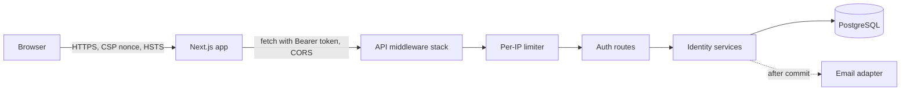

# Security Design — U1 Walking Skeleton

**Sources:** `nfr-requirements/security-requirements.md` (NFR2.x, NFR3.x, NFR6.x), `functional-design/functional-spec.md` (WF-U1-1 to WF-U1-7), `contract-summary.md` (C1 `/auth/*`, C11 error codes), and NFR design answer Q3.

Security is designed in layers. Each layer stops a different class of attack, so one missing control does not open the slice.


Text fallback: the browser talks to the Next.js app over HTTPS with a strict CSP. The app calls the API cross-origin with a Bearer token. Each API request passes through the middleware stack and then the per-IP limiter (auth routes only) before reaching the routes and services. Services store state in PostgreSQL, and email is sent only after the database commit.

## 1. Backend request pipeline (order matters)

| Order | Layer | What it enforces | Requirement |
|---|---|---|---|
| 1 | Request-id middleware | Accepts a well-formed `X-Request-ID` or generates a UUID; sets it on the log context and the response | NFR5.7 |
| 2 | Body-size guard | Rejects bodies over 16 KB on `/auth/*` with 413 before parsing | NFR9 resource limits, STRIDE DoS |
| 3 | CORS (Starlette `CORSMiddleware`) | Only the configured `FRONTEND_ORIGIN`, with credentials; the allowed and exposed headers listed in NFR2.12 | NFR2.12 |
| 4 | Security-headers middleware | `nosniff`, `Referrer-Policy: no-referrer`, `Cache-Control: no-store` on `/auth/*`, and HSTS outside development | NFR2.13, NFR3.5 |
| 5 | Exception handlers | Map domain errors to the C11 envelope `{code, message, requestId}`; unknown errors become `INTERNAL_ERROR`; stack traces are logged only | NFR3.3, NFR5.9 |
| 6 | Per-IP limiter dependency | Applied on register, login and verify only (see §4) | NFR2.9 |
| 7 | Auth dependency `current_user` | Applied to every router by default; the public allow-list opts out explicitly | NFR2.8, NFR2.11 |

**Secure by default:** the app factory mounts protected routers with `dependencies=[Depends(current_user)]`. Public routes live in one `public_router` whose paths must equal the constant `PUBLIC_ROUTES`. A start-up assertion and a test compare the two sets, so a new public route cannot appear silently (NFR2.8).

## 2. Credentials and codes

| Concern | Design | Requirement |
|---|---|---|
| Password hashing | `PasswordHasher` port with an Argon2id adapter (`argon2-cffi`; m=19 MiB, t=2, p=1; parameters from settings). `verify_and_maybe_rehash()` returns a new hash when the parameters change; the login service stores it | NFR2.2 |
| Password policy | A pure `PasswordPolicy` value-object check: length 8–128, at least one letter and one digit, and not in a bundled list of 10k common passwords (loaded once at start-up into a frozenset) | NFR2.3 |
| Login enumeration | The login service always runs one Argon2 verification: against the stored hash, or against a module-level dummy hash when the user is missing or unverified. It returns the same `INVALID_CREDENTIALS` either way | NFR2.4 |
| Code generation | `secrets.randbelow(10**6)`, zero-padded to 6 digits | NFR2.5 |
| Code storage | `HMAC-SHA256(CODE_HMAC_KEY, f"{user_id}:{purpose}:{code}")`, hex digest; compared with `hmac.compare_digest` | NFR2.5 |
| Attempt counting | One row per (user, purpose) in `verification_attempts`, locked with `SELECT … FOR UPDATE` in the verify transaction | NFR2.5, NFR2.10 |

**Verify transaction (atomic, NFR2.10):**
```text
BEGIN
  counter = SELECT … FROM verification_attempts WHERE user_id=:u AND purpose=:p FOR UPDATE
  if counter.locked_until > now: ROLLBACK → 429 CODE_LOCKED
  code = latest live code for (u, p)  -- consumed_at IS NULL AND superseded_at IS NULL
  if missing or expired: COMMIT → 400 CODE_EXPIRED
  if not compare_digest(hmac(u, p, input), code.hash):
      counter.failed += 1; maybe set locked_until = now + 15 min; COMMIT → 400 CODE_INVALID or 429 CODE_LOCKED
  UPDATE codes SET consumed_at=now WHERE id=:id AND consumed_at IS NULL  -- rowcount must be 1
  counter.failed = 0; mark user verified; create RefreshSession; COMMIT → 200 tokens
```
Because the counter row is locked, parallel guesses run one at a time. The conditional update makes a second correct submission fail with `CODE_EXPIRED` (the code is already used).

## 3. Tokens and session cookie

| Concern | Design | Requirement |
|---|---|---|
| Access token | `TokenService.issue_access(user)` builds the claims `sub, role, iat, exp(+15m), typ="access", jti` and signs them with the active key from `JWT_SIGNING_KEYS` (a JSON map `kid → base64 secret` plus `JWT_ACTIVE_KID`) | NFR2.6 |
| Verification | `jwt.decode(..., algorithms=["HS256"], options={"require": ["exp","iat","sub","typ"]})`. The key is chosen by the header `kid`; an unknown `kid` or a `typ` other than `access` returns 401 `UNAUTHENTICATED` | NFR2.6 |
| Rotation | Add a new `kid`, switch `JWT_ACTIVE_KID`, then remove the old key after 15 minutes. Both keys verify during the overlap | NFR2.6 |
| Refresh cookie | 32 random bytes; the cookie value is `{token_id}.{base64url(secret)}`; the database stores `sha256(secret)`. Attributes come from settings (`HttpOnly`, `Max-Age=604800`, `Path=/auth`, `SameSite=Lax`, `Secure` when `APP_ENV` is not development) | NFR2.7 |
| CSRF | U1 has no endpoint that reads the cookie, so there is no CSRF surface. U2's refresh and logout endpoints add the `X-Requested-With` + Origin check (deferred, as recorded in the requirements) | NFR2 deferred note |

## 4. Abuse controls

| Control | Design | Requirement |
|---|---|---|
| Per-IP limiter | `RateLimiter` port with `check_and_record(key, limit, window) -> Decision`. The PostgreSQL adapter keeps a table `rate_limit_hits(key, hit_at)` with an index on `(key, hit_at)`. It records the hit and counts the window in **its own short transaction on a separate session**, so the request's later rollback cannot erase the hit. Key = `"{route}:{client_ip}"`. Rows older than 1 hour are deleted by the adapter on about 1% of calls | NFR2.9, NFR11.2 |
| Client IP | The socket peer address. `X-Forwarded-For` is honoured only when the peer is in `TRUSTED_PROXIES` (empty by default) | NFR2.9 |
| 429 response | `RATE_LIMITED` envelope plus `Retry-After` (seconds until the oldest hit leaves the window) | NFR2.9 |
| Global email cap | The same limiter with key `"email:global"`, limit `AUTH_EMAIL_HOURLY_CAP`, window 3600 s, checked just before sending. When exceeded: 503 `UPSTREAM_UNAVAILABLE` and a WARN log `auth.email_cap_reached` | STRIDE (email bombing) |

## 5. Browser and frontend security

| Concern | Design | Requirement |
|---|---|---|
| CSP (answer Q3) | Next.js `middleware.ts` generates a 16-byte nonce per request and sets `Content-Security-Policy: default-src 'self'; script-src 'self' 'nonce-{n}' 'strict-dynamic'; style-src 'self' 'unsafe-inline'; img-src 'self' data:; connect-src 'self' {API_ORIGIN}; frame-ancestors 'none'; base-uri 'self'; form-action 'self'`. The nonce reaches the layout through a request header. Inline styles stay allowed because Tailwind and shadcn/ui inject style attributes; scripts do not | NFR2.13 |
| Other headers (frontend) | `X-Content-Type-Options`, `Referrer-Policy: no-referrer` and HSTS (outside development) in `next.config` `headers()` | NFR2.13, NFR3.5 |
| Token storage | A Zustand store without `persist` holds `accessToken` and `user` in memory. Only `lib/auth/*` may import the store's setters (enforced by ESLint `no-restricted-imports`) | NFR2.14, NFR7.2 |
| API client | One `apiClient` adds `Authorization: Bearer`, `credentials: "include"` (so U2's cookie flow works unchanged) and the `X-Requested-With: fetch` header | NFR2.12, NFR2.14 |

## 6. Data protection and secrets

| Concern | Design | Requirement |
|---|---|---|
| Log redaction | A JSON formatter with an allow-list of fields. `mask_email()` is the only way an email enters a log. Request bodies are never logged | NFR3.2, NFR5.12 |
| Ownership | A `require_owner(resource_user_id)` helper raises `NotFound` (404) for a mismatch. U1 tests it directly, and later units reuse it | NFR3.4 |
| Settings | pydantic-settings `Settings` with `SecretStr` for keys. Validators reject a missing key, a key shorter than 32 bytes, `EMAIL_BACKEND=fake` in production, and insecure cookies outside development/test, so start-up fails fast | NFR6.1, NFR6.2, NFR3.5 |
| Secret scanning | Gitleaks pre-commit hook and CI job; `.env` is in `.gitignore`; `.env.example` holds placeholders only | NFR6.1 |

## 7. Supply chain
CI runs `pip-audit` and `pnpm audit --prod` (fail on high or critical), and a lockfile deny-list script fails on Supabase or auth-SaaS packages (NFR1.3, NFR2.1). Dependabot opens weekly update PRs.
