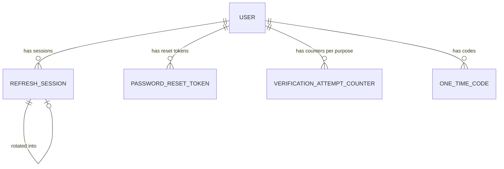

# Functional Specification — U2 Session Security

**Scope:** stories US11.7, US3.3, US3.5, US3.6, US3.7, US3.9, US3.10, US3.11 and US11.5 (36 acceptance criteria).

**Endpoints (contract C1):** `/auth/resend-code`, `/auth/refresh`, `/auth/logout`, `/auth/password/forgot`, `/auth/password/verify-code`, `/auth/password/reset` and `/auth/change-password`. U1 already provides `/auth/register`, `/auth/verify`, `/auth/login` and `/auth/me`.

**Error codes (C11):** `SESSION_INVALID`, `CSRF_CHECK_FAILED`, `RESET_TOKEN_INVALID`, `CODE_*` and `INVALID_CREDENTIALS`. A `SESSION_INVALID` error carries one detail item whose `reason` is `EXPIRED`, `REUSE_DETECTED`, `REVOKED` or `INVALID`.

This file is the source of truth for workflows and state machines. The ER view and the rules summary are derived from `entities.md` and `rules.md`.

## 1. Workflows

### WF-U2-1 — Resend a code
**Actor:** visitor on the code screen. **Trigger:** the countdown ends and they choose "Send a new code".
1. The frontend sends `POST /auth/resend-code` with the email and purpose (the purpose comes from the screen's flow).
2. The per-IP limiter applies (U1 NFR2.9).
3. The backend looks up the account and checks the purpose-specific state (BR1.6). If none matches → respond 202 with the standard shape and send nothing (BR1.5).
4. Lockout check: while `lockedUntil > now` → 429 `CODE_LOCKED` with `Retry-After` (BR1.3).
5. Cooldown check: before `lastSentAt + 60 s` → 429 `CODE_RESEND_COOLDOWN` with `Retry-After` (BR1.1).
6. Issue a new code. This supersedes the old one (BR1.2) and runs commit → send → compensate (U1 reliability design). Respond 202 with `maskedEmail`, `resendAvailableAt` and `expiresAt`.
7. The frontend shows a success toast, restarts the 60 s countdown from `resendAvailableAt`, and clears the code field.

### WF-U2-2 — Restore the session on app start
**Actor:** returning user. **Trigger:** first load or reload of any page.
1. The store starts with `status = initializing`. Protected pages render the full-page loading indicator, never the login form (BR6.1).
2. The client takes the cross-tab refresh lock (WF-U2-4) and calls `POST /auth/refresh` with `X-Requested-With: XMLHttpRequest` and credentials.
3. **200:** the store saves `accessToken`, `accessTokenExpiresAt` and `user`, sets `status = signedIn` and schedules the proactive refresh (WF-U2-3).
4. **401 `SESSION_INVALID`:** `status = signedOut`. Protected pages redirect to `/login`. A reason of `REUSE_DETECTED` or `REVOKED` sets `signedOutReason = security`, so login shows the security message (BR6.7).
5. **Network error or 5xx:** stay `initializing`, show "We couldn't reach the server" with a Retry button, and do not route to login (BR6.5).

### WF-U2-3 — Proactive refresh and 401 retry (single-flight)
1. When a token is stored, schedule one refresh at `accessTokenExpiresAt − 60 s` (BR6.2).
2. Any request that gets 401 with code `NOT_AUTHENTICATED` joins the in-flight refresh, or starts one if none exists (BR6.3).
3. The refresh call itself is sent outside the 401 handler, so its own 401 never triggers another refresh (BR6.4).
4. **Refresh succeeds:** each waiting request is retried once with the new token. A retried request that gets 401 again is rejected and not retried (BR6.4).
5. **Refresh returns 401:** reject all waiters, clear the store once, set `signedOutReason`, and navigate to `/login` once (BR6.5).
6. **Refresh fails with a network error or 5xx:** reject waiters with an error toast. The user stays signed in, and the next request tries again (BR6.5).

### WF-U2-4 — Cross-tab refresh coordination (ADR-006)
1. Every refresh (start-up, proactive or after a 401) first requests the browser-wide lock `auth-refresh` through the Web Locks API (BR6.6).
2. With the lock held:
   - If another tab broadcast a refresh result within the last 5 seconds, adopt that access token and expiry. No network call is made.
   - Otherwise call `/auth/refresh`, then broadcast `{type: "refreshed", accessToken, expiresAt, user}` on the `auth` BroadcastChannel.
3. Release the lock. Other tabs waiting on the lock then adopt the broadcast result (step 2).
4. **Fallback:** when Web Locks is missing, use a BroadcastChannel claim-and-wait. When both are missing, each tab refreshes on its own. This race is accepted for unsupported browsers (ADR-006).
5. Tabs also listen for `{type: "signedOut", reason}`. When one arrives, they clear their store and go to login (BR3.4).

### WF-U2-5 — Reuse detection and CSRF (server)
1. `POST /auth/refresh` and `POST /auth/logout` check the CSRF headers first: `X-Requested-With: XMLHttpRequest`, and `Origin` (or `Referer` when `Origin` is absent) must be on the allow-list. On failure → 403 `CSRF_CHECK_FAILED`, with no session read or changed (BR2.5).
2. Refresh parses the cookie `tokenId.secret`, loads the session with a row lock, and compares the secret hash in constant time:
   - Unknown session, wrong secret or revoked session → 401, reason `INVALID` or `REVOKED`, and the cookie is cleared (BR2.4).
   - Expired session → 401, reason `EXPIRED`, and the cookie is cleared (BR2.2).
   - Already rotated → revoke the whole family (`reuse_detected`) and return 401, reason `REUSE_DETECTED`, with the cookie cleared (BR2.3).
   - Otherwise, rotate (BR2.1): set `rotatedAt` on the old session and create a child in the same family. Return 200 with `accessToken` and `expiresAt`, and Set-Cookie with the new value and attributes (BR2.8).
3. Steps 2 and 3 run in one transaction, so two concurrent refreshes with the same cookie produce one rotation and one reuse detection, never two children.

### WF-U2-6 — Log out
1. The user chooses Log out in the header menu. The confirmation dialog opens ("Log out?", confirm button "Log out") (BR3.2, BR7.3).
2. **Cancel or Escape:** nothing happens, and focus returns to the menu button.
3. **Confirm:** the store calls `POST /auth/logout` (with the CSRF headers). The server revokes the session if it is usable, clears the cookie, and responds 204 (BR3.1).
4. Whatever the outcome (204, network error or 5xx), the tab clears its store, broadcasts `{type: "signedOut", reason: "logout"}` (BR3.4), shows a "You're logged out" toast, and routes to `/login`.
5. Replaying the old cookie on `/auth/refresh` later gives 401 `SESSION_INVALID`, reason `REVOKED` (AC3.7.3).

### WF-U2-7 — Forgot password (three steps)
1. **Request.** `/forgot-password` sends `POST /auth/password/forgot` with the email.
   - The backend applies the per-IP limiter.
   - If a verified account exists and is not in cooldown or lockout for `password_reset`, it issues a code (commit → send → compensate) and records the reset request time (BR1.6).
   - It always responds 202 with no body difference (BR4.1). The screen shows the same neutral message and no outcome toast.
2. **Verify code.** The code screen (`purpose = password_reset`) sends `POST /auth/password/verify-code`. The rules are the same as U1's verify with that purpose (BR4.2). On success, any earlier unused reset tokens are marked used, a new opaque token is created and its hash stored, and the response is 200 with `resetToken` and `expiresAt` (BR4.3).
3. **Set new password.** `/reset-password` holds the reset token in page memory only and sends `POST /auth/password/reset` with `resetToken` and `newPassword`.
   - Refusals: a used, expired or unknown token → 401 `RESET_TOKEN_INVALID` (BR4.4); a weak password → 422 `VALIDATION_FAILED` (BR4.5).
   - On success, one transaction updates the password, marks the token used and revokes every refresh session with reason `password_reset` (BR4.6). The response is 204.
   - The screen shows "Password changed — please log in" (a success toast) and routes to `/login`.

### WF-U2-8 — Change password (signed in)
1. **Settings → Password** shows the current, new and confirm fields, with live password-rule hints.
2. The form checks that new equals confirm. If not, an inline error appears on confirm and nothing is sent (BR5.2).
3. The store sends `POST /auth/change-password` (Bearer token and refresh cookie) with `currentPassword` and `newPassword`. The per-IP limiter applies.
4. **Wrong current password:** 401 `INVALID_CREDENTIALS`, shown inline on the current field plus an error toast. The API client does **not** treat this as an expired session (BR5.1, BR6.4).
5. **Weak new password:** 422 `VALIDATION_FAILED`, shown inline on the new field.
6. **Success:** the new hash is stored. The session named by the request's refresh cookie is kept, and all other usable sessions are revoked with reason `password_changed` (BR5.3). The response is 204 and a success toast appears. The user stays signed in, and other devices are signed out at their next refresh.

### WF-U2-9 — Toasts, dialog and inline errors (app-wide)
1. A single `toast` service exposes `success(message)` and `error(message)`. Success toasts use a polite live region and auto-dismiss after 5 s. Error toasts use an assertive live region and persist until dismissed. Neither takes focus (BR7.1, BR7.2).
2. A single `confirm({title, body, confirmLabel})` returns a promise of true or false. The dialog traps focus, Escape resolves false, and focus returns to the opener (BR7.3).
3. Forms map server field details to inline errors (`aria-invalid` and `aria-describedby`). A toast may add context, but the inline error is always present (BR7.4).
4. On a phone-width screen, the toast region sits under the header, with at most three toasts stacked (BR7.5).

## 2. State machines

### Refresh session
| From | Event | Guard | To | Actions |
|---|---|---|---|---|
| Active | refresh | not expired, secret matches | Rotated | create child (Active) in same family |
| Active | refresh | now ≥ expiresAt | Expired | 401 EXPIRED, clear cookie |
| Rotated | refresh (replay) | — | Revoked | revoke whole family (reuse_detected), 401 REUSE_DETECTED |
| Active | logout | — | Revoked | reason logout |
| Active | password reset | — | Revoked | reason password_reset (all of user's sessions) |
| Active | password change | not the current session | Revoked | reason password_changed |
| Revoked / Expired | refresh | — | (unchanged) | 401 REVOKED / EXPIRED |

### Password reset token
| From | Event | Guard | To | Actions |
|---|---|---|---|---|
| — | reset code verified | — | Issued | earlier unused tokens → Used |
| Issued | reset | now < expiresAt | Used | password changed, sessions revoked |
| Issued | reset | now ≥ expiresAt | Expired | 401 RESET_TOKEN_INVALID |
| Used / Expired | reset | — | (unchanged) | 401 RESET_TOKEN_INVALID |

### Client session (each tab)
| From | Event | To | Actions |
|---|---|---|---|
| initializing | restore refresh 200 | signedIn | save token, schedule refresh |
| initializing | restore refresh 401 | signedOut | set reason; protected pages → login |
| initializing | network / 5xx | initializing | show retry message |
| signedOut | code verified (sign-up / login) | signedIn | save token, schedule refresh |
| signedIn | proactive or 401 refresh 200 | signedIn | replace token, reschedule |
| signedIn | refresh 401 | signedOut | clear once, navigate once, reason from server |
| signedIn | refresh network / 5xx | signedIn | error toast |
| signedIn | logout confirmed | signedOut | revoke, broadcast, toast, → login |
| signedIn | broadcast signedOut | signedOut | clear, → login |

## 3. Entity relationship view (derived from `entities.md`)

Text fallback: a user has many refresh sessions, reset tokens, codes and one attempt counter per purpose. A refresh session can be rotated into one child session in the same family.

## 4. Rules summary (derived from `rules.md`)
- **BR1:** resend cooldown and lockout. Unknown emails get the same answer.
- **BR2:** rotation, strict reuse detection, CSRF on the cookie endpoints, and cookie attributes.
- **BR3:** logout with confirmation, never on lifecycle events, all tabs sign out.
- **BR4:** a three-step reset with an opaque single-use 10-minute token. A successful reset revokes all sessions.
- **BR5:** change password. The current session is kept and other sessions are revoked.
- **BR6:** client restore, proactive refresh, single-flight retry, clearing only on 401 or logout, the cross-tab lock, and the security message.
- **BR7:** toasts, confirmation dialog, inline errors and phone layout.

## 5. Integration points
| With | How | Notes |
|---|---|---|
| U1 Identity services | Reuses code issue/verify (with purpose), password hasher and policy, TokenService, cookie helpers, limiter and email dispatcher | No change to U1 behaviour, except replacing U1's "start again" expired-code link with the real resend |
| U1 WebAuthClient | Extends the store and API client with restore, refresh, single-flight, cross-tab and logout | The U1 rule "reload signs out" (U1 BR5.4) is replaced by WF-U2-2 |
| U10 Settings | Hosts the Password section built here (WF-U2-8); U10 adds account info and billing | The route `/settings/password` lives in U2 |
| All later units | Use the shared toast and confirmation dialog | US11.7 applies from U2 onwards |

## 6. Edge cases
- **Two tabs reload at the same moment:** the lock serialises them, and the second adopts the first one's result, so the family is not revoked (AC3.11.1).
- **A tab is asleep past the proactive refresh time:** the next request gets 401, joins a refresh and retries, and the user sees no error.
- **Logout fails on the network:** the client still clears and broadcasts. The server session expires on its own, and its cookie was not cleared, but it can no longer be used by a store that holds no token. It is revoked at the next logout, or reuse is detected if it is replayed after rotation elsewhere.
- **Password reset while another device is signed in:** that device's next refresh gets 401 `REVOKED` and shows the security message.
- **Change password from a device whose refresh cookie is missing:** the request still needs a valid Bearer token. No session can be identified as "current", so every session is revoked, and the user is told to log in again on this device.
- **Clock skew:** all server checks use the server clock. The client schedules from the server's `expiresAt`, offset by the local time at receipt.
