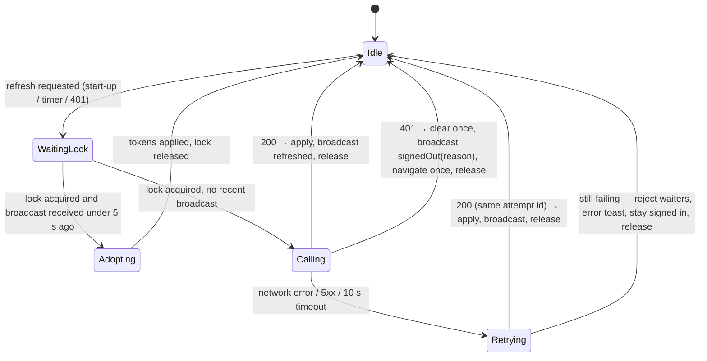

# Reliability Design — U2 Session Security

**Sources:** `nfr-requirements/reliability-requirements.md` (NFR5.1–NFR5.8), the functional design WF-U2-2 to WF-U2-4 with its post-review note, and ADR-006.

## 1. Refresh coordinator (client) — state and failure handling

Text fallback: a refresh request waits for the browser lock. With the lock held, the tab adopts a refresh broadcast received in the last 5 seconds, or calls the server itself. On a network error, a 5xx or a 10-second timeout, it retries once with the same attempt id. On a 401 it signs out exactly once and tells the other tabs. The lock is always released.

| Concern | Design | Requirement |
|---|---|---|
| Single flight in a tab | One shared promise, `inflight`. Every caller (start-up, timer, 401 handler) awaits it. It is cleared in `finally` | NFR5.4 |
| Single flight across tabs | `navigator.locks.request("auth-refresh", {mode:"exclusive"}, fn)`. Inside `fn`, if a `refreshed` broadcast was received less than 5 s ago (by local receipt time), adopt it instead of calling the server | NFR5.4, ADR-006 |
| Fallback | Without Web Locks: a BroadcastChannel claim (`{type:"claim", id}`), then wait 150 ms for an older claim, the lower id winning, and a 12 s cap. Without both: per-tab refresh | NFR5.8 |
| Timeout | `AbortController` with 10 s per refresh call, so `fn` always settles and the lock is released | NFR5.3 |
| Lost response | One retry with the same attempt id. The server recovery is in security design §1 | NFR5.2 |
| Network or 5xx | Waiters reject with `ApiError{code:"NETWORK_ERROR" or "UPSTREAM"}`. One error toast per refresh failure. Status stays `signedIn` (or `initializing` on start-up, which shows Retry) | NFR5.1 |
| Clear exactly once | `signOut(reason)` is idempotent for each generation. Navigation goes through `router.replace("/login")`, guarded by a flag | NFR5.5 |
| Retry budget | A request carries `retried: true` after its single retry. The refresh call bypasses the 401 handler | NFR5.4 |

## 2. Server-side reliability

| Concern | Design | Requirement |
|---|---|---|
| Email after the response | `BackgroundTasks` runs the U1 email dispatcher (bulkhead of 10, 25 s budget, retries). A final failure logs `vendor.failed` at ERROR and supersedes the issued code, so the user's next resend works | NFR5.6 |
| Atomic credential changes | Reset: token consume, password update and revocations in one transaction. Change: password update and revocations in one transaction. Any exception rolls everything back | NFR5.7 |
| Refresh atomicity | Row lock on the presented session (security design §1). All writes commit together | NFR2.4 |
| Clean-up (answer Q1) | `python -m app.identity.cleanup` deletes, in batches of 1,000: refresh sessions expired, rotated or revoked more than 30 days ago; reset tokens used or expired more than 30 days ago; shadow counters idle more than 1 day with no lock. It is idempotent, safe to run at any time, and documented in the README. A host scheduler runs it daily once one exists | NFR11.3 |
