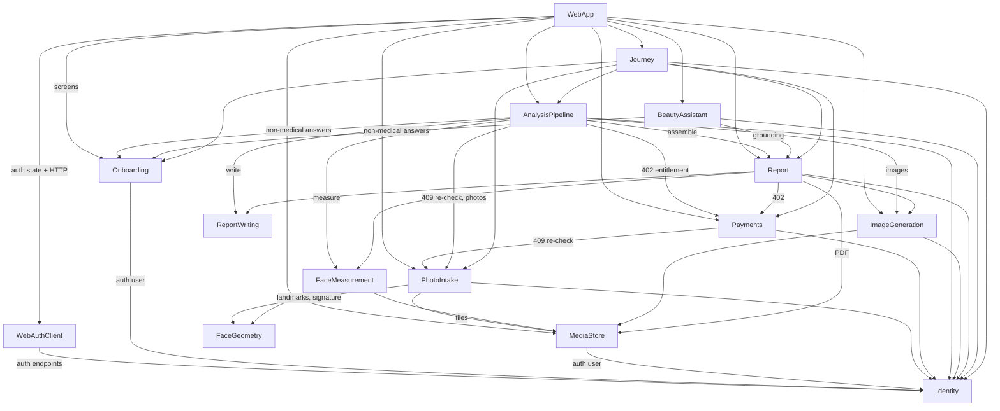

# Components — AI Facial Analysis Platform

These are the logical building blocks of the system: **code we write, not infrastructure we deploy.** PostgreSQL, file storage, OpenAI, Stripe, the email provider and the MediaPipe model are dependencies *of* components, not components.

This document does not decide deployment (Units Generation does) or full schemas (Functional Design does). Entities are captured at the ownership-and-shape level only.

**Sources:**
- `inception/requirements-analysis/requirements.md` (FR/NFR)
- `inception/user-stories/stories.md` (US)
- `inception/refined-mockups/`
- the team practices
- the client's fixed layering (client §5.3)
- answers Q1–Q6 in `domain-design-questions.md`

Decisions are recorded in `decisions.md` (ADR-001 to ADR-010).

## Part A — Component catalogue

```yaml
components:
  - name: Identity
    summary: Accounts, sign-up/login with password plus emailed one-time code, JWT and refresh sessions, password reset and change.
    behaviour: >
      Custom, backend-controlled authentication only (AUTH-001, CON-002). Two-step sign-up and login: password first,
      then a 6-digit emailed code; tokens are issued only after the code is verified (AUTH-003). Codes are stored hashed,
      expire after 10 minutes, have a 60-second resend cooldown and a 5-attempt / 15-minute lockout per account and purpose;
      a resend invalidates the previous code (AUTH-011, US3.3). Access tokens are 15-minute JWTs; refresh tokens last 7 days,
      are rotated on every use, are stored only as a token identifier, and reuse of a rotated token revokes the whole
      family (AUTH-010, AUTH-012). Refresh and logout require X-Requested-With plus an Origin/Referer allow-list (AUTH-013).
      Password reset issues a single-use, ~10-minute reset token after code verification and revokes all sessions on
      success (AUTH-015). Change password keeps the current session (AUTH-016). Passwords are slow-hashed; the password rule
      is at least 8 characters with a letter and a number, common passwords rejected (stories Q14). Every user has a role
      field, currently always "user" (AUTH-009). JWT and OTP logic live in internal services decoupled from route handlers
      (client §5.3). Also answers "who am I" and exposes account info for Settings.
    responsibilities:
      - User accounts, verification status, role, member-since date
      - One-time codes for sign-up, login and password reset
      - Access-token issue and validation for every protected endpoint (shared auth dependency)
      - Refresh-session rotation, reuse detection, revocation, logout
      - Password reset and in-session password change
    depends_on: []
    dependents:
      - component: WebAuthClient
        interaction: Calls register, login, verify-code, refresh, logout, who-am-I, reset and change-password endpoints
      - component: Onboarding
        interaction: Resolves the authenticated user for every request (shared auth dependency)
      - component: PhotoIntake
        interaction: Resolves the authenticated user for every request
      - component: Payments
        interaction: Resolves the authenticated user for checkout and history
      - component: AnalysisPipeline
        interaction: Resolves the authenticated user for start and status
      - component: Report
        interaction: Resolves the authenticated user for report and PDF access
      - component: ImageGeneration
        interaction: Resolves the authenticated user for image retry
      - component: BeautyAssistant
        interaction: Resolves the authenticated user for chat
      - component: Journey
        interaction: Resolves the authenticated user for the next-step query
      - component: MediaStore
        interaction: Resolves the authenticated user before serving a private file
    external_dependencies:
      - name: PostgreSQL
        kind: database
        purpose: Users, code records, refresh sessions, reset tokens
      - name: Email provider (behind an adapter; local mail catcher in development)
        kind: third-party-api
        purpose: Delivering sign-up, login and reset codes (NFR-012)
    entities:
      - name: User
        identifier: userId
        attributes: [fullName, email, passwordHash, isVerified, role, createdAt]
      - name: OneTimeCode
        identifier: codeId
        attributes: [userId, purpose, codeHash, expiresAt, attemptCount, lockedUntil, consumedAt, supersededAt]
        references:
          - entity: User
            owned_by: Identity
            relationship: each code belongs to one user (or pending sign-up user)
      - name: RefreshSession
        identifier: tokenId
        attributes: [userId, familyId, parentTokenId, issuedAt, expiresAt, rotatedAt, revokedAt]
        references:
          - entity: User
            owned_by: Identity
            relationship: each session belongs to one user
      - name: PasswordResetToken
        identifier: resetTokenId
        attributes: [userId, tokenHash, expiresAt, usedAt]
        references:
          - entity: User
            owned_by: Identity
            relationship: each reset token belongs to one user

  - name: Onboarding
    summary: Consent and the configurable, branching questionnaire with its mandatory disclaimer.
    behaviour: >
      The user must give explicit, versioned consent before the questionnaire (requirements Q2, FR4.1). The questionnaire
      definition (questions, types, options, branching, follow-ups, medical flags, disclaimer text) is data loaded from
      seed/configuration, never code (FR4.2); the working content is the 23-question specification [QS]. Branching shows
      or skips questions from earlier answers; a follow-up inherits its parent's medical flag (US4.2). Answers are saved as
      the user advances and can be edited before submission. Submission is refused unless the disclaimer is confirmed
      (BR-003); a user who cannot confirm sees a supportive message and cannot proceed (stories Q13). Other components get
      answers only through a query that returns question text with each answer and EXCLUDES every medical-flagged answer
      unless the caller is inside Onboarding (FR8.6).
    responsibilities:
      - Consent capture with text version
      - Questionnaire definition loading and branching evaluation
      - Saving, editing and submitting answers
      - Disclaimer gate (server-side)
      - Providing non-medical answers with question text to AI-facing components
    depends_on:
      - component: Identity
        interaction: Authenticated user for every request
        style: sync
    dependents:
      - component: WebApp
        interaction: Consent, questionnaire and submit screens
        style: sync
      - component: AnalysisPipeline
        interaction: Reads submitted non-medical answers with question text for the AI request
      - component: BeautyAssistant
        interaction: Reads non-medical answers for chat grounding
      - component: Journey
        interaction: Asks whether consent exists and the questionnaire is submitted
    external_dependencies:
      - name: PostgreSQL
        kind: database
        purpose: Consent records, questionnaire definitions and responses
    entities:
      - name: ConsentRecord
        identifier: consentId
        attributes: [userId, consentTextVersion, givenAt]
        references:
          - entity: User
            owned_by: Identity
            relationship: each consent record belongs to one user
      - name: QuestionnaireDefinition
        identifier: definitionVersion
        attributes: [questions, branchingRules, disclaimerText, createdAt]
      - name: QuestionnaireResponse
        identifier: responseId
        attributes: [userId, definitionVersion, answers, disclaimerConfirmedAt, submittedAt, updatedAt]
        references:
          - entity: User
            owned_by: Identity
            relationship: each user has at most one questionnaire response
          - entity: QuestionnaireDefinition
            owned_by: Onboarding
            relationship: each response was answered against one definition version

  - name: FaceGeometry
    summary: Stateless face-landmark service — 478-point landmarks, pose estimate and identity signature.
    behaviour: >
      Wraps MediaPipe Face Landmarker. Loads a pinned model version once per process; caches only the model, never results
      ([IV] §5). Returns landmarks or a typed "no face" / "multiple faces" result; estimates head pose for angle checks;
      computes the 5-ratio identity signature normalised by inter-eye distance (ASM-010). Deterministic: the same image
      gives the same output. Owns no data.
    responsibilities:
      - Landmark detection
      - Head-pose estimation
      - Identity-signature computation and pairwise distance
    depends_on: []
    dependents:
      - component: PhotoIntake
        interaction: Face count, pose and occlusion checks; identity signatures for the same-person vote
      - component: FaceMeasurement
        interaction: Landmarks for measurements and assessments
    external_dependencies:
      - name: MediaPipe Face Landmarker model + OpenCV
        kind: other
        purpose: Local computer-vision libraries (not a third-party service)
    entities: []

  - name: MediaStore
    summary: Private storage for photos, generated images and PDFs behind a swappable storage adapter.
    behaviour: >
      Saves files through a configured backend (local disk in development; an object-store adapter later, host undecided
      NFR-010). Files are never served from a public path; reads go through an authenticated endpoint that checks the
      requesting user owns the file. Replacing a file deletes the old one. Photos are re-encoded on write, which strips
      location/device metadata (US5.8). HEIC is converted on upload (stories Q14).
    responsibilities:
      - Store, replace, delete and read files
      - Owner-checked private file access
      - Metadata stripping and format conversion on write
    depends_on:
      - component: Identity
        interaction: Authenticated user before serving a private file
        style: sync
    dependents:
      - component: PhotoIntake
        interaction: Stores and replaces angle photos
      - component: FaceMeasurement
        interaction: Reads the current photos for measurement
      - component: ImageGeneration
        interaction: Reads source photos; stores generated images
      - component: Report
        interaction: Stores and reads the cached PDF
      - component: WebApp
        interaction: Loads images through owner-checked URLs
    external_dependencies:
      - name: File storage (local disk now; object store later)
        kind: object-store
        purpose: Private binary storage
    entities:
      - name: StoredFile
        identifier: fileId
        attributes: [ownerUserId, kind, contentType, byteSize, storageKey, createdAt]
        references:
          - entity: User
            owned_by: Identity
            relationship: each stored file belongs to one user

  - name: PhotoIntake
    summary: Per-angle photo upload, per-photo validation and the three-photo same-person check.
    behaviour: >
      Accepts one photo per configured angle (REQUIRED_ANGLES, default front / left 3/4 / right 3/4, ASM-005); a retake
      replaces the photo for that angle (BR-005). Accepts JPEG, PNG and HEIC up to 10 MB (stories Q14). Per-photo checks:
      readable image, minimum resolution, brightness/exposure, exactly one face, face-to-frame proportion, eyes/mouth not
      covered, pose matches the angle; thresholds are configuration (FR-006, ASM-002). Once all angles pass, computes the
      same-person result fresh from the current photos every time, nothing cached, using the match-count vote: all match →
      none; one with zero matches → that one; all mismatch → both non-front; hub case → exactly one non-front (BR-005, [IV]
      §3). A pair counts as a match when its distance is ≤ the threshold (0.6 initially, [IV]). Exposes one shared
      check function used by Payments (checkout) and the Analysis Pipeline (start) for their 409 re-check. Rejection
      reasons describe the photo, never the person (stories Q11).
    responsibilities:
      - Photo upload, replace and status per angle
      - Per-photo validation with plain-language reasons
      - Same-person decision (single shared function)
      - Supplying the current photo set to analysis
    depends_on:
      - component: Identity
        interaction: Authenticated user for every request
        style: sync
      - component: FaceGeometry
        interaction: Landmarks, pose and identity signatures
        style: sync
      - component: MediaStore
        interaction: Store and replace photo files
        style: sync
    dependents:
      - component: WebApp
        interaction: Capture, upload and review screens
      - component: Payments
        interaction: Same-person re-check at checkout (409)
      - component: AnalysisPipeline
        interaction: Same-person re-check at start (409) and the current photo set
      - component: Journey
        interaction: Asks whether the photo set is complete and consistent
    external_dependencies:
      - name: PostgreSQL
        kind: database
        purpose: Photo records and validation results
    entities:
      - name: Photo
        identifier: photoId
        attributes: [userId, angle, fileId, validationStatus, validationReasons, uploadedAt]
        references:
          - entity: User
            owned_by: Identity
            relationship: each user has at most one photo per angle
          - entity: StoredFile
            owned_by: MediaStore
            relationship: each photo points to its current stored file

  - name: Payments
    summary: One-time Stripe Checkout per report, webhook confirmation, payment entitlement and billing history.
    behaviour: >
      Creates a Stripe hosted Checkout session at the configured price and currency (FR-016, OQ-002) only when the photo
      set passes the same-person re-check (409 otherwise). Payment status changes only through a Stripe webhook whose
      signature is verified against the raw body; events are idempotent by Stripe event id (US6.3). The webhook never
      starts analysis (FR-015). Answers "has this user paid for their report?" for other components (requirements Q4 /
      domain Q4). Provides billing history for Settings. PayPal is never integrated (BR-012).
    responsibilities:
      - Checkout session creation
      - Webhook verification and idempotent status updates
      - Payment entitlement query
      - Billing history
    depends_on:
      - component: Identity
        interaction: Authenticated user for checkout and history
        style: sync
      - component: PhotoIntake
        interaction: Same-person re-check before checkout
        style: sync
    dependents:
      - component: WebApp
        interaction: Payment, confirming and billing screens
      - component: AnalysisPipeline
        interaction: Entitlement check before starting a run (402)
      - component: Report
        interaction: Entitlement check before serving a report (402)
      - component: Journey
        interaction: Asks payment state (none, pending confirmation, paid)
    external_dependencies:
      - name: Stripe API (behind an adapter)
        kind: third-party-api
        purpose: Hosted Checkout and webhooks
      - name: PostgreSQL
        kind: database
        purpose: Payments and processed webhook events
    entities:
      - name: Payment
        identifier: paymentId
        attributes: [userId, stripeSessionId, status, amount, currency, createdAt, confirmedAt]
        references:
          - entity: User
            owned_by: Identity
            relationship: each payment belongs to one user
      - name: ProcessedWebhookEvent
        identifier: stripeEventId
        attributes: [eventType, receivedAt, paymentId]
        references:
          - entity: Payment
            owned_by: Payments
            relationship: each processed event updated at most one payment

  - name: AnalysisPipeline
    summary: Owns the analysis run — explicit start, ordered resumable steps, progress, failure and the one free re-run.
    behaviour: >
      Starts a run only on the user's explicit action (FR-015), after the payment check (402, checked first) and the
      same-person re-check (409). At most one run per payment, plus one free re-run after a failed run (stories Q8);
      concurrent starts return the same run. Runs as a background job with named steps: measuring → writing → generating
      images → assembling. Each step saves its output so a restart resumes without repeating a step or a paid call.
      Collects non-medical answers from Onboarding and hands measurements + answers + photos to Report Writing; generates
      images with a configurable concurrency limit and back-off on rate limits; asks Report to assemble and publish.
      A report is published even when some images failed (FR10.5). Target: done within 10 minutes (NFR4).
    responsibilities:
      - Run creation, idempotent start and re-run policy
      - Step orchestration, resume and failure recording
      - Progress reporting for the progress screen
    depends_on:
      - component: Identity
        interaction: Authenticated user for start and status
        style: sync
      - component: Payments
        interaction: Entitlement check before start
        style: sync
      - component: PhotoIntake
        interaction: Same-person re-check and current photo set
        style: sync
      - component: Onboarding
        interaction: Non-medical answers with question text
        style: sync
      - component: FaceMeasurement
        interaction: Measurement and assessment step
        style: async
      - component: ReportWriting
        interaction: AI text step
        style: async
      - component: ImageGeneration
        interaction: 24-image generation step
        style: async
      - component: Report
        interaction: Assemble and publish the report
        style: async
    dependents:
      - component: WebApp
        interaction: Start button, progress and re-run screens
      - component: Journey
        interaction: Asks whether a run is in progress, failed or complete
    external_dependencies:
      - name: PostgreSQL
        kind: database
        purpose: Runs and step state (also backs the background job queue)
    entities:
      - name: AnalysisRun
        identifier: runId
        attributes: [userId, paymentId, attemptNumber, status, currentStep, failureReason, startedAt, finishedAt]
        references:
          - entity: User
            owned_by: Identity
            relationship: each run belongs to one user
          - entity: Payment
            owned_by: Payments
            relationship: each run is covered by one payment
      - name: RunStep
        identifier: runStepId
        attributes: [runId, stepName, status, attempts, completedAt]
        references:
          - entity: AnalysisRun
            owned_by: AnalysisPipeline
            relationship: each step belongs to one run

  - name: FaceMeasurement
    summary: Geometric measurements per feature and the facial assessments (symmetry, thirds, dimorphism, prototypicality, face shape).
    behaviour: >
      Measures the seven front-mesh features (Eyebrows, Eyes, Nose, Cheeks, Jaw, Lips, Chin) from the front photo, and
      each ear from its own side's 3/4 photo with a front fallback (FR-007; seven-feature reading to be confirmed by the
      client). Hair, Skin and Neck use documented heuristics or an explicit "no measurement" marker — never an invented
      number. Computes symmetry 0–100 with label and Regional Balance, facial thirds, dimorphism, prototypicality and
      face shape as first-pass heuristics (FR-018); formulas and label bands are fixed in Functional Design.
      Deterministic for the same photos.
    responsibilities:
      - Per-feature measurements
      - Facial assessment scores and labels
    depends_on:
      - component: FaceGeometry
        interaction: Landmarks for each photo
        style: sync
      - component: MediaStore
        interaction: Read the current photos
        style: sync
    dependents:
      - component: AnalysisPipeline
        interaction: Runs the measuring step
      - component: Report
        interaction: Reads measurements and assessments for display
    external_dependencies:
      - name: PostgreSQL
        kind: database
        purpose: Measurement sets and assessments
    entities:
      - name: MeasurementSet
        identifier: measurementSetId
        attributes: [runId, userId, featureMeasurements, algorithmVersion, createdAt]
        references:
          - entity: AnalysisRun
            owned_by: AnalysisPipeline
            relationship: each measurement set is produced by one run
      - name: FacialAssessment
        identifier: assessmentId
        attributes: [measurementSetId, symmetryScore, symmetryLabel, regionalBalance, facialThirds, dimorphism, prototypicality, faceShape]
        references:
          - entity: MeasurementSet
            owned_by: FaceMeasurement
            relationship: each assessment is derived from one measurement set

  - name: ReportWriting
    summary: AI-written report text — per-feature narrative, projected potential, summary callout and tiered recommendations.
    behaviour: >
      Builds the multimodal gpt-4o request from photos, measurements and the NON-medical answers with their question text
      (FR-008 a–e; medical answers never sent, FR8.6). Adds the reassuring-tone instruction when distress answers pass a
      configured level. Requests structured output validated against a schema: 11 features, 3–5 sentence narratives
      citing a stored value for measured features, potential ideas, summary, and recommendations each labelled with one
      of three tiers; a missing or invalid tier falls back to configured keyword rules (stories Q3). Invalid output is
      retried a configured number of times, then the step fails with a reason. Base URL, key and model are configuration
      (NFR-008). Never writes raw field names ([RT] §13).
    responsibilities:
      - Prompt assembly (the privacy- and tone-critical part)
      - AI call, validation, retry
      - Storing report text and tiered recommendations
    depends_on: []
    dependents:
      - component: AnalysisPipeline
        interaction: Runs the writing step with the inputs it gathered
      - component: Report
        interaction: Reads the stored report text
    external_dependencies:
      - name: OpenAI text/vision API (behind an adapter)
        kind: third-party-api
        purpose: Narrative and recommendation generation
      - name: PostgreSQL
        kind: database
        purpose: Report text
    entities:
      - name: ReportText
        identifier: reportTextId
        attributes: [runId, featureSections, closingRecommendations, promptVersion, model, createdAt]
        references:
          - entity: AnalysisRun
            owned_by: AnalysisPipeline
            relationship: each report text is produced by one run

  - name: ImageGeneration
    summary: The 24 AI images per report — 11 per-feature "after" images, 5 hairstyles, 5 outfits, 3 aging cards — with retries.
    behaviour: >
      Uses image editing of the user's own photo at high input fidelity through a vendor adapter selected by configuration
      (NFR-013; gpt-image-1 by default). Creates 24 image slots per run. Each failed generation is retried automatically up
      to 3 times; a still-failed slot is marked "not available yet" and the user may retry it manually up to 3 times
      (stories Q10). The healthy-aging "current" card is the user's own photo, not generated (FR-020).
    responsibilities:
      - Image slot creation and generation
      - Automatic and manual retry with caps
      - Storing generated images
    depends_on:
      - component: Identity
        interaction: Authenticated user for manual retry
        style: sync
      - component: MediaStore
        interaction: Read source photo; store generated images
        style: sync
    dependents:
      - component: AnalysisPipeline
        interaction: Runs the image step
      - component: Report
        interaction: Reads image slots and their state
      - component: WebApp
        interaction: Manual retry of a failed image
    external_dependencies:
      - name: OpenAI image API or another configured vendor (behind an adapter)
        kind: third-party-api
        purpose: Image editing
      - name: PostgreSQL
        kind: database
        purpose: Image slots and attempts
    entities:
      - name: GeneratedImage
        identifier: imageId
        attributes: [runId, userId, slotKind, slotKey, status, autoAttempts, manualRetries, fileId, updatedAt]
        references:
          - entity: AnalysisRun
            owned_by: AnalysisPipeline
            relationship: each image slot belongs to one run
          - entity: StoredFile
            owned_by: MediaStore
            relationship: a ready image points to its stored file

  - name: Report
    summary: The published report — assembly, auto-publish, static template sections, report views and cached PDF.
    behaviour: >
      Assembles one report per user from measurements, assessments, report text and image slots, and publishes it
      immediately with no review (BR-002, FR-014). Exactly 11 features in fixed order, no Smile section (BR-008,
      BR-011). Introduction, preamble and limitations are static configured template copy; the preamble always comes
      before any score (stories Q11). Serves the Home dashboard data ([RD] §4) and the interactive report; returns 402
      without payment and 404 for another user's report. Generates the PDF on first download, caches it, and regenerates
      it when any image slot changes (US8.5).
    responsibilities:
      - Assembly and publishing
      - Report and dashboard read models
      - PDF generation and cache invalidation
      - Static template content
    depends_on:
      - component: Identity
        interaction: Authenticated user
        style: sync
      - component: Payments
        interaction: Entitlement check (402)
        style: sync
      - component: FaceMeasurement
        interaction: Measurements and assessments
        style: sync
      - component: ReportWriting
        interaction: Report text and recommendations
        style: sync
      - component: ImageGeneration
        interaction: Image slots and states
        style: sync
      - component: MediaStore
        interaction: Store and read the cached PDF
        style: sync
    dependents:
      - component: AnalysisPipeline
        interaction: Assemble and publish at the end of a run
      - component: BeautyAssistant
        interaction: Reads the report as chat grounding
      - component: Journey
        interaction: Asks whether a report exists
      - component: WebApp
        interaction: Home, report, AI Visuals and PDF download
    external_dependencies:
      - name: PostgreSQL
        kind: database
        purpose: Report records
      - name: Headless Chromium
        kind: other
        purpose: Rendering the PDF from the report page
    entities:
      - name: Report
        identifier: reportId
        attributes: [userId, runId, templateVersion, publishedAt, pdfFileId, pdfSourceVersion]
        references:
          - entity: User
            owned_by: Identity
            relationship: each user has at most one report
          - entity: AnalysisRun
            owned_by: AnalysisPipeline
            relationship: each report is published from one run
          - entity: StoredFile
            owned_by: MediaStore
            relationship: the cached PDF is one stored file

  - name: BeautyAssistant
    summary: Chat about the user's own report, grounded in it, declining medical questions, with a daily limit.
    behaviour: >
      Grounds each answer in the user's report (measurements, assessments, narratives) and non-medical answers (FR-019);
      medical answers are never sent (FR8.6). The system instructions always include the medical-decline rule. Enforces a
      configurable daily limit (initially 50 successful messages per UTC day); failed AI calls don't count; concurrent
      sends at the limit are serialised so exactly the limit is accepted (stories Q10). Keeps conversation history.
    responsibilities:
      - Conversation history
      - Grounded prompt assembly
      - Daily usage limit
    depends_on:
      - component: Identity
        interaction: Authenticated user
        style: sync
      - component: Report
        interaction: Grounding content
        style: sync
      - component: Onboarding
        interaction: Non-medical answers
        style: sync
    dependents:
      - component: WebApp
        interaction: Chat screen
    external_dependencies:
      - name: OpenAI text API (behind an adapter)
        kind: third-party-api
        purpose: Chat replies
      - name: PostgreSQL
        kind: database
        purpose: Conversations, messages and daily usage
    entities:
      - name: ChatConversation
        identifier: conversationId
        attributes: [userId, reportId, createdAt]
        references:
          - entity: Report
            owned_by: Report
            relationship: each conversation is about one report
      - name: ChatMessage
        identifier: messageId
        attributes: [conversationId, role, text, status, createdAt]
        references:
          - entity: ChatConversation
            owned_by: BeautyAssistant
            relationship: each message belongs to one conversation
      - name: DailyChatUsage
        identifier: usageKey
        attributes: [userId, utcDate, successfulMessages]
        references:
          - entity: User
            owned_by: Identity
            relationship: one usage counter per user per UTC day

  - name: Journey
    summary: Read-only "what is this user's next step?" — used by every entry point and the route guard.
    behaviour: >
      Owns no data (domain Q3). Asks each owning component for its state and applies the fixed order: no consent →
      consent; questionnaire not submitted → questionnaire; photos incomplete or inconsistent → photos; unpaid →
      payment; returned from Stripe but unconfirmed → confirming; paid, not started → start; running or failed → progress;
      report exists → home (US11.8, BR-005 rule 7).
    responsibilities:
      - Next-step computation
    depends_on:
      - component: Identity
        interaction: Authenticated user
        style: sync
      - component: Onboarding
        interaction: Consent and submission state
        style: sync
      - component: PhotoIntake
        interaction: Photo set completeness and consistency
        style: sync
      - component: Payments
        interaction: Payment state
        style: sync
      - component: AnalysisPipeline
        interaction: Run state
        style: sync
      - component: Report
        interaction: Report exists
        style: sync
    dependents:
      - component: WebApp
        interaction: Route guard and "Get started"
    external_dependencies: []
    entities: []

  - name: WebAuthClient
    summary: Frontend auth store (Zustand, memory only) and the single API client every request goes through.
    behaviour: >
      Holds the access token, user profile and initializing flag in memory only; never uses persist or Web Storage; never
      holds the refresh token (FE-001–FE-003). The API client attaches the token, sends cookies and X-Requested-With,
      refreshes ~1 minute before expiry, retries once on 401 with a single shared refresh, and clears auth only when
      refresh returns 401 or the user logs out (FE-004–FE-006). Tabs coordinate so only one tab refreshes at a time and
      the others reuse its result, keeping the server's reuse detection strict (domain Q6, ADR-006). Restores the session
      on app start before protected routes render.
    responsibilities:
      - Auth state (single source of truth in the browser)
      - Token attachment, proactive and on-401 refresh, cross-tab coordination
      - Session restore on start
    depends_on:
      - component: Identity
        interaction: Auth endpoints over HTTP
        style: sync
    dependents:
      - component: WebApp
        interaction: Auth state and the HTTP client for every call
    external_dependencies: []
    entities: []

  - name: WebApp
    summary: The Next.js user interface — feature modules for every screen in the mockups, shared UI kit.
    behaviour: >
      Feature folders mirror the backend components (domain Q5). UI components never call auth APIs or touch tokens
      (FE-007, lint-enforced). All HTTP goes through WebAuthClient's API client. Implements the screens, states and
      accessibility in inception/refined-mockups (WCAG 2.1 AA, one look, light theme). Toasts for every outcome and a shared
      confirmation dialog for destructive actions (BR-009, BR-010).
    responsibilities:
      - Screens and interactions
      - Route guard using Journey
      - Client-side validation mirroring backend rules
    depends_on:
      - component: WebAuthClient
        interaction: Auth state and HTTP client
        style: sync
      - component: Onboarding
        interaction: Consent and questionnaire (via API client)
        style: sync
      - component: PhotoIntake
        interaction: Photos (via API client)
        style: sync
      - component: Payments
        interaction: Payment and billing (via API client)
        style: sync
      - component: AnalysisPipeline
        interaction: Start and progress (via API client)
        style: sync
      - component: Report
        interaction: Home, report, visuals, PDF (via API client)
        style: sync
      - component: ImageGeneration
        interaction: Manual image retry (via API client)
        style: sync
      - component: BeautyAssistant
        interaction: Chat (via API client)
        style: sync
      - component: Journey
        interaction: Next step (via API client)
        style: sync
      - component: MediaStore
        interaction: Owner-checked image and PDF URLs (via API client)
        style: sync
    dependents: []
    external_dependencies: []
    entities: []
```

---

## Part B — Human-readable view

### Component diagram


Text fallback: WebApp → WebAuthClient → Identity is the fixed auth path. Payments checks PhotoIntake. AnalysisPipeline checks Payments and PhotoIntake, reads Onboarding, then drives FaceMeasurement → ReportWriting → ImageGeneration → Report. Report reads all the analysis outputs. BeautyAssistant reads Report and Onboarding. Journey reads every stateful block. FaceGeometry and MediaStore are leaf services. Every backend block uses Identity for the signed-in user. The graph has no cycles.

### Component summary

| Component | Purpose | Depends On | Dependents | Entities Owned |
|---|---|---|---|---|
| Identity | Accounts, codes, tokens, sessions, password reset/change | — | WebAuthClient, Onboarding, PhotoIntake, Payments, AnalysisPipeline, Report, ImageGeneration, BeautyAssistant, Journey, MediaStore | User, OneTimeCode, RefreshSession, PasswordResetToken |
| Onboarding | Consent, branching questionnaire, disclaimer | Identity | WebApp, AnalysisPipeline, BeautyAssistant, Journey | ConsentRecord, QuestionnaireDefinition, QuestionnaireResponse |
| FaceGeometry | Landmarks, pose, identity signature | — | PhotoIntake, FaceMeasurement | — |
| MediaStore | Private file storage | Identity | PhotoIntake, FaceMeasurement, ImageGeneration, Report, WebApp | StoredFile |
| PhotoIntake | Photo upload, validation, same-person check | Identity, FaceGeometry, MediaStore | WebApp, Payments, AnalysisPipeline, Journey | Photo |
| Payments | Stripe checkout, webhook, entitlement, history | Identity, PhotoIntake | WebApp, AnalysisPipeline, Report, Journey | Payment, ProcessedWebhookEvent |
| AnalysisPipeline | Run lifecycle, steps, resume, re-run | Identity, Payments, PhotoIntake, Onboarding, FaceMeasurement, ReportWriting, ImageGeneration, Report | WebApp, Journey | AnalysisRun, RunStep |
| FaceMeasurement | Measurements and assessments | FaceGeometry, MediaStore | AnalysisPipeline, Report | MeasurementSet, FacialAssessment |
| ReportWriting | AI report text and tiered recommendations | — | AnalysisPipeline, Report | ReportText |
| ImageGeneration | 24 AI images with retries | Identity, MediaStore | AnalysisPipeline, Report, WebApp | GeneratedImage |
| Report | Assembly, publish, views, PDF | Identity, Payments, FaceMeasurement, ReportWriting, ImageGeneration, MediaStore | AnalysisPipeline, BeautyAssistant, Journey, WebApp | Report |
| BeautyAssistant | Grounded chat with daily limit | Identity, Report, Onboarding | WebApp | ChatConversation, ChatMessage, DailyChatUsage |
| Journey | Next-step computation (read-only) | Identity, Onboarding, PhotoIntake, Payments, AnalysisPipeline, Report | WebApp | — |
| WebAuthClient | Browser auth store + single API client | Identity | WebApp | — |
| WebApp | All screens | WebAuthClient, Onboarding, PhotoIntake, Payments, AnalysisPipeline, Report, ImageGeneration, BeautyAssistant, Journey, MediaStore | — | — |

### Entity ownership

| Entity | Owning Component | Identifier | Attributes | References |
|---|---|---|---|---|
| User | Identity | userId | fullName, email, passwordHash, isVerified, role, createdAt | — |
| OneTimeCode | Identity | codeId | userId, purpose, codeHash, expiresAt, attemptCount, lockedUntil, consumedAt, supersededAt | User |
| RefreshSession | Identity | tokenId | userId, familyId, parentTokenId, issuedAt, expiresAt, rotatedAt, revokedAt | User |
| PasswordResetToken | Identity | resetTokenId | userId, tokenHash, expiresAt, usedAt | User |
| ConsentRecord | Onboarding | consentId | userId, consentTextVersion, givenAt | User |
| QuestionnaireDefinition | Onboarding | definitionVersion | questions, branchingRules, disclaimerText, createdAt | — |
| QuestionnaireResponse | Onboarding | responseId | userId, definitionVersion, answers, disclaimerConfirmedAt, submittedAt, updatedAt | User, QuestionnaireDefinition |
| StoredFile | MediaStore | fileId | ownerUserId, kind, contentType, byteSize, storageKey, createdAt | User |
| Photo | PhotoIntake | photoId | userId, angle, fileId, validationStatus, validationReasons, uploadedAt | User, StoredFile |
| Payment | Payments | paymentId | userId, stripeSessionId, status, amount, currency, createdAt, confirmedAt | User |
| ProcessedWebhookEvent | Payments | stripeEventId | eventType, receivedAt, paymentId | Payment |
| AnalysisRun | AnalysisPipeline | runId | userId, paymentId, attemptNumber, status, currentStep, failureReason, startedAt, finishedAt | User, Payment |
| RunStep | AnalysisPipeline | runStepId | runId, stepName, status, attempts, completedAt | AnalysisRun |
| MeasurementSet | FaceMeasurement | measurementSetId | runId, userId, featureMeasurements, algorithmVersion, createdAt | AnalysisRun |
| FacialAssessment | FaceMeasurement | assessmentId | measurementSetId, symmetryScore, symmetryLabel, regionalBalance, facialThirds, dimorphism, prototypicality, faceShape | MeasurementSet |
| ReportText | ReportWriting | reportTextId | runId, featureSections, closingRecommendations, promptVersion, model, createdAt | AnalysisRun |
| GeneratedImage | ImageGeneration | imageId | runId, userId, slotKind, slotKey, status, autoAttempts, manualRetries, fileId, updatedAt | AnalysisRun, StoredFile |
| Report | Report | reportId | userId, runId, templateVersion, publishedAt, pdfFileId, pdfSourceVersion | User, AnalysisRun, StoredFile |
| ChatConversation | BeautyAssistant | conversationId | userId, reportId, createdAt | Report |
| ChatMessage | BeautyAssistant | messageId | conversationId, role, text, status, createdAt | ChatConversation |
| DailyChatUsage | BeautyAssistant | usageKey | userId, utcDate, successfulMessages | User |

Every entity has exactly one owner. References cross components by id only. Client data entities are mapped as follows:
- `DATA-001` → User
- `DATA-002` → OneTimeCode
- `DATA-003` → RefreshSession
- `DATA-004` → QuestionnaireResponse
- `DATA-005` → Photo
- `DATA-006` → MeasurementSet + FacialAssessment + ReportText
- `DATA-007` → Report
- `DATA-008` → Payment
- `DATA-009` / `DATA-010` → GeneratedImage (per-feature and visuals slots)
- `DATA-011` → ChatConversation + ChatMessage

### External dependencies

| Component | Dependency | Kind | Purpose |
|---|---|---|---|
| Identity | PostgreSQL | database | Accounts, codes, sessions |
| Identity | Email provider (adapter; mail catcher locally) | third-party-api | Code delivery |
| Onboarding | PostgreSQL | database | Consent, definitions, responses |
| FaceGeometry | MediaPipe + OpenCV | other | Local CV libraries |
| MediaStore | File storage (local now, object store later) | object-store | Private files |
| PhotoIntake | PostgreSQL | database | Photo records |
| Payments | Stripe API (adapter) | third-party-api | Checkout, webhooks |
| Payments | PostgreSQL | database | Payments, events |
| AnalysisPipeline | PostgreSQL | database | Runs, steps, job queue |
| FaceMeasurement | PostgreSQL | database | Measurements |
| ReportWriting | OpenAI text/vision (adapter) | third-party-api | Report text |
| ReportWriting | PostgreSQL | database | Report text |
| ImageGeneration | OpenAI image or other vendor (adapter) | third-party-api | Image editing |
| ImageGeneration | PostgreSQL | database | Image slots |
| Report | PostgreSQL | database | Reports |
| Report | Headless Chromium | other | PDF rendering |
| BeautyAssistant | OpenAI text (adapter) | third-party-api | Chat |
| BeautyAssistant | PostgreSQL | database | Chat, usage |

### Rationale

| Component | Why it is a separate building block |
|---|---|
| Identity | Security-critical, test-first code with its own data (sessions, codes); client mandates it be isolated behind JWT/OTP services (§5.3) |
| Onboarding | Owns the only health data; its content changes by configuration, not code; the medical-answer filter must live beside that data |
| FaceGeometry | One model shared by photo checks and measurements (domain Q2, ADR-002); keeps both consistent and loads the model once |
| MediaStore | One privacy boundary for every face image and PDF; storage backend will change when hosting is chosen |
| PhotoIntake | Distinct lifecycle (upload/retake) and the test-first same-person rule, reused by checkout and start |
| Payments | External money flow with its own failure modes, idempotency and webhook security |
| AnalysisPipeline | Owns run state and resume; the only place that knows step order and the re-run policy (domain Q1, ADR-001) |
| FaceMeasurement | CV algorithms tuned separately from AI prompts; deterministic and fully testable offline |
| ReportWriting | Prompt and model changes are frequent; owns the privacy-critical prompt assembly |
| ImageGeneration | Vendor-swappable (NFR-013), high cost, its own retry caps |
| Report | Publishing, template copy and PDF change with design, not with analysis logic |
| BeautyAssistant | Separate interaction model (conversation), its own cost limit and safety rule |
| Journey | Cross-cutting read-only rule; keeping it data-free avoids a second source of truth (domain Q3, ADR-003) |
| WebAuthClient | Client-mandated single auth store and API client (§5.3, FE-003) |
| WebApp | The UI, organised by feature to mirror the backend (domain Q5, ADR-008) |

**Alternatives rejected** (details in `decisions.md`):
- a single "Analysis" block (ADR-001);
- landmarks inside PhotoIntake (ADR-002);
- a stored progress record (ADR-003);
- a webhook creating the run (ADR-004);
- a server-side refresh grace window (ADR-006);
- route-only frontend folders (ADR-008).
