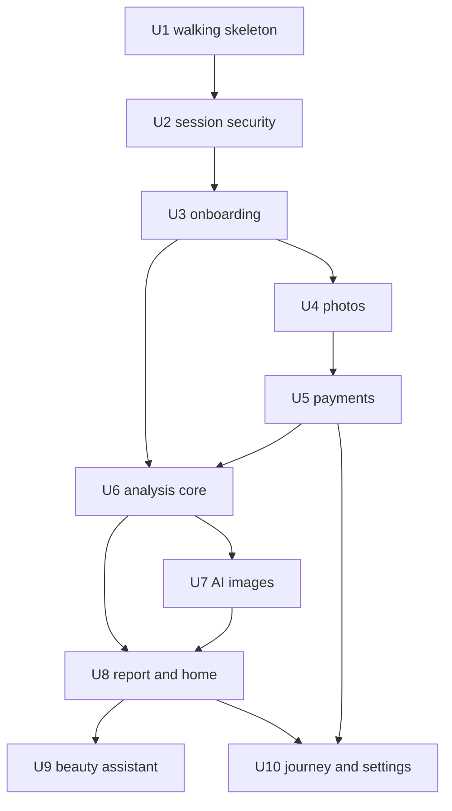

# Unit Dependencies — AI Facial Analysis Platform

This describes the topology only: which unit needs which other unit to exist first. The build order and the reasons for it are decided in Delivery Planning. Edges come from the story dependencies in `stories.md` (a unit depends on another when one of its stories lists a story in that unit under `Deps`) and from the component dependencies in `components.md`.

## Machine-readable edge block

```yaml
units:
  - name: u1-walking-skeleton
    kind: service
    depends_on: []
  - name: u2-session-security
    kind: service
    depends_on: [u1-walking-skeleton]
  - name: u3-onboarding
    kind: service
    depends_on: [u2-session-security]
  - name: u4-photos
    kind: service
    depends_on: [u3-onboarding]
  - name: u5-payments
    kind: service
    depends_on: [u4-photos]
  - name: u6-analysis-core
    kind: service
    depends_on: [u3-onboarding, u5-payments]
  - name: u7-ai-images
    kind: service
    depends_on: [u6-analysis-core]
  - name: u8-report-home
    kind: service
    depends_on: [u6-analysis-core, u7-ai-images]
  - name: u9-beauty-assistant
    kind: service
    depends_on: [u8-report-home]
  - name: u10-journey-settings
    kind: service
    depends_on: [u5-payments, u8-report-home]
```

## Dependency graph


Arrows point from the prerequisite to the dependent unit ("U2 → U3" means U3 depends on U2).

Text fallback: U1 → U2 → U3 → U4 → U5 → U6 → U7 → U8. U6 also needs U3, and U8 also needs U6. U9 needs U8. U10 needs U5 and U8. There are no cycles.

## Why each edge exists

| Dependent | Depends on | Reason (story or component dependency) |
|---|---|---|
| U2 | U1 | US3.5 needs US3.4 login; US3.10 needs US1.9 auth store |
| U3 | U2 | US4.1 needs sign-in; the questionnaire screens use the toast and dialog from US11.7, and session restore from US3.5 |
| U4 | U3 | US5.1 (photo requirements) follows the submitted questionnaire (US4.3) |
| U5 | U4 | US6.1 needs a consistent photo set (US5.6); checkout re-checks identity (PhotoIntake) |
| U6 | U5 | US7.1 needs the paywall (US6.4) and entitlement (Payments) |
| U6 | U3 | US7.4 needs non-medical answers (US4.2, Onboarding) |
| U7 | U6 | US9.1 needs the pipeline (US7.6) and image adapter (US1.12) |
| U8 | U6 | US8.1 needs report text (US7.9) and assessments (US7.5, US7.10) |
| U8 | U7 | Report reads image slots (ImageGeneration); US8.7 shows them |
| U9 | U8 | US10.1 needs the report (US8.1) as grounding |
| U10 | U8 | US11.8 needs "report exists"; US1.13 checks every screen |
| U10 | U5 | US11.6 billing needs payments (US6.3) |

## Integration points between units

| From → To | Integration | Mechanism |
|---|---|---|
| All backend units → U1/U2 (Identity) | Authenticated user for every request | In-process auth dependency (FastAPI dependency) |
| Frontend (all units) → backend | Every feature call | HTTP/JSON through the single API client (U1 WebAuthClient) |
| U5 → U4 | Same-person re-check at checkout | In-process call to PhotoIntake's shared check function |
| U6 → U4 | Same-person re-check at start; the run's photo file ids | In-process calls |
| U6 → U5 | Entitlement (402) | In-process call to Payments |
| U6 → U3 | Non-medical answers with question text | In-process query (ADR-007) |
| U6 → U7 | Image step | Background worker step calling ImageGeneration |
| U8 → U6, U7 | Measurements, assessments, report text, image slots | In-process reads |
| U8 → U5 | Entitlement (402) on report read | In-process call |
| U9 → U8, U3 | Grounding and non-medical answers | In-process reads |
| U10 → U3, U4, U5, U6, U8 | Next-step state from each owner | In-process reads (Journey owns no data) |
| All → PostgreSQL | Each module owns its tables; no module writes another's tables | Shared database, module-owned tables (modular monolith) |

The exact operations, payloads and error codes at these boundaries are defined in Contract Design.

## Parallel development opportunities

- **U9 and U10** have no dependency on each other, so either can be built first, or both in parallel.
- **Inside units**, some stories are independent. For example, in U4, MediaStore (US1.10) and FaceGeometry (US1.11) can be built in parallel.
- Everything else forms one chain, because each journey step needs the one before it (questionnaire → photos → payment → analysis → images → report).

## Walking skeleton

The team practice is "always build a walking skeleton first" (team practices). **U1 is the first unit in the DAG** and has no dependencies. It runs on its own: sign-up → emailed code (read from the local mail catcher) → verify → login → "who am I", across Next.js, FastAPI and PostgreSQL, with the GitHub Actions workflow green. None of its stories depend on stories in later units. It is verified with the Construction Verification Command (a Playwright journey plus the CI checks) and approved at the skeleton checkpoint before U2 starts.
